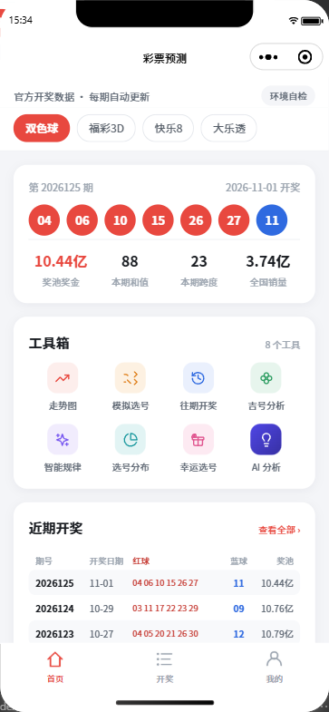
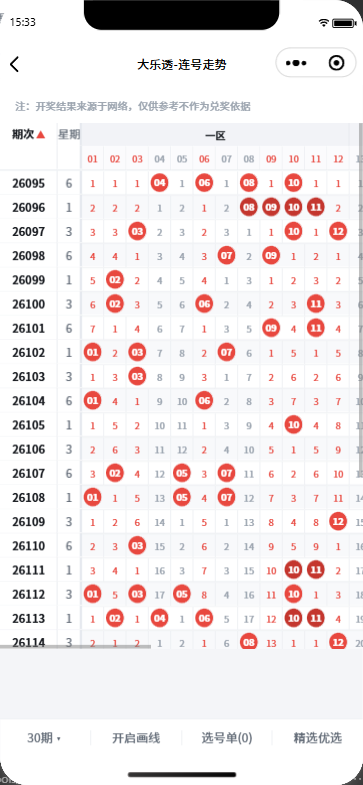
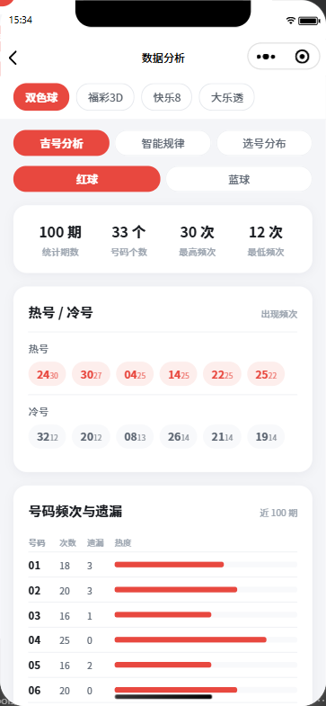
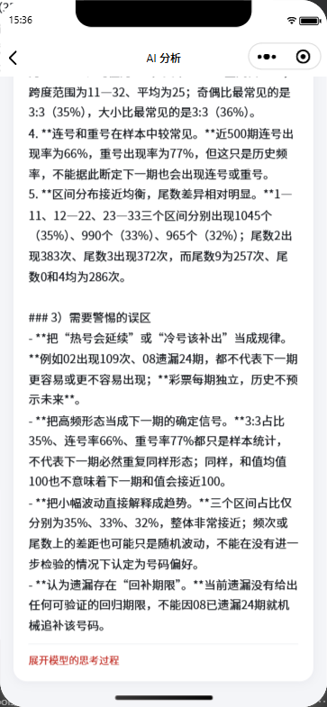

# 彩票预测小程序 · 环境搭建

微信云开发原生小程序工程。仓库当前处于**「环境就绪 + UI 可运行」**状态：
开发者工具能打开、能编译、能跑模拟器、能被自动化脚本驱动，
11 个页面（底部 tab 三页 + 7 个工具页 + 环境自检）全部有真实数据，
自动化验证 **81/81 通过**。

**开奖数据已接通**：双色球 / 福彩3D / 快乐8 / 大乐透四个彩种，
各取最近 500 期入库（云库共 2000 条），数据来自**官方开奖接口**（福彩 + 体彩），
每期开奖后自动更新。自动更新有**两层保障**：每日 22:00 定时触发器
（需在控制台上传一次配置）+ 客户端打开时的兜底自动同步（已上线）。
详见「六、开奖数据源与同步机制」。

## 功能一览

| 模块 | 说明 |
| --- | --- |
| 首页 | 彩种切换、最新一期开奖、工具箱入口、近 10 期号码 |
| 开奖 | 四个彩种的历史开奖列表，按期号 / 日期翻页 |
| 走势图 | 36 种统计口径的号码分布矩阵（和值、跨度、奇偶、区间……） |
| 往期开奖 | 分页浏览历史期次，支持期号检索 |
| 幸运选号 | 按规则随机生成号码（模拟选号，不是预测） |
| 吉号分析 | 频次 / 遗漏 / 规律 / 区间分布等纯前端统计 |
| AI 分析 | 把本地统计指标喂给大模型生成解读（可选，需自备 API Key） |
| 我的 | 授权登录、我的预测记录、AI 服务配置 |
| 环境自检 | 一键检查 AppID / 云环境 / 云函数 / 数据是否就位 |

## 界面预览

| 首页 | 走势图 |
| :---: | :---: |
|  |  |

| 吉号分析 | AI 分析 |
| :---: | :---: |
|  |  |

> 更多页面：[开奖](design/screenshot-draws.png) ·
> [往期开奖](design/screenshot-history.png) ·
> [幸运选号](design/screenshot-pick.png) ·
> [选号分布](design/screenshot-analysis-dist.png) ·
> [智能规律](design/screenshot-analysis-pattern.png) ·
> [AI 设置](design/screenshot-ai-settings.png) ·
> [环境自检](design/screenshot-debug.png) ·
> [我的](design/screenshot-mine.png)
>
> 全页面画廊（约 3 MB）：[design/all-pages.png](design/all-pages.png) ·
> 设计稿源文件：[design/home.pen](design/home.pen)、[design/all-pages.pen](design/all-pages.pen)

> ⚠️ **免责声明**
> 本项目是**开源技术示例**，只做开奖数据的统计与可视化（频次、遗漏、分布、走势），
> **不提供也不承诺任何「中奖预测」**。彩票开奖是独立随机事件，
> 历史统计无法提高中奖概率。请理性购彩，未满 18 周岁禁止购买彩票。

## 开源说明

- 协议：**MIT**（见 [LICENSE](LICENSE)）。
- **需要自备**：自己的小程序 AppID、自己的云开发环境、自己的模型 API Key。
  `project.config.json` 与 `miniprogram/envList.js` 里已留好占位符，
  克隆后按下面「三、快速开始」替换成你自己的即可。
- 工程文档写得比较细（含 36 条踩坑记录），是为了让后来者少走弯路，
  也可以当成微信小程序 + 云开发的一份实战参考。

---

## 一、本机环境实测

以下数据由 `scripts/setup-check.ps1` 从本机探测得出，不是抄来的：

| 项 | 值 |
| --- | --- |
| 微信开发者工具 | 2.02.2608080 @ `<开发者工具安装目录>` |
| CLI | `<开发者工具安装目录>\cli.bat` |
| 服务端口 | 24501（`.ide` 文件实测） |
| 自动化端口 | 9420 |
| 基础库 | 3.17.5 |
| Node / npm | v25.6.1 / 11.12.1 |
| npm 源 | `registry.npmmirror.com`（国内加速） |
| Git | 2.39.0.windows.2 |

环境变了（换机、升级 IDE、IDE 重启导致端口变）就重跑一次：

```powershell
cd scripts; .\setup-check.ps1
```

它会重新生成 `miniprogram/devtool.config.js`，首页「环境速查」卡片读的就是这份文件。

---

## 二、目录结构

```
Lottery predictions/
├─ project.config.json          # IDE 工程配置（appid 占位符在这里换）
├─ sitemap.json
├─ miniprogram/                 # 小程序主包
│  ├─ app.js / app.json / app.wxss
│  ├─ envList.js                # 云环境 ID —— 全项目唯一数据源
│  ├─ devtool.config.js         # 本机环境速查表（setup-check.ps1 生成）
│  ├─ utils/
│  │  ├─ cloud.js               # 云函数调用封装（超时/错误翻译）
│  │  ├─ api.js                 # API 层：函数名收口 + 业务方法
│  │  ├─ lottery.js             # 彩种元信息（号码个数/范围/有序性）
│  │  ├─ analysis.js            # 频次/遗漏/规律/分布算法（纯前端）
│  │  ├─ ai.js                  # AI 客户端（客户端直连 MiniMax）
│  │  ├─ ai-prompt.js           # 统计指标 → 结构化 prompt（纯前端）
│  │  └─ layout.js              # 安全区 / rpx 换算
│  └─ pages/
│     ├─ index/                 # 首页：彩种切换 + 最新开奖 + 工具箱 + 近 10 期
│     ├─ draws/                 # 开奖（tab 2）
│     ├─ mine/                  # 我的（tab 3）：授权登录 + 记录 + AI 设置入口
│     ├─ tools/
│     │  ├─ trend/              # 走势图：index 选择页 + detail 表格页
│     │  ├─ history/            # 往期开奖
│     │  ├─ pick/               # 幸运选号 / 模拟选号
│     │  ├─ analysis/           # 吉号分析 / 智能规律 / 选号分布
│     │  ├─ ai-settings/        # AI 设置：端点 / 模型 / 密钥 / 温度 / 风格
│     │  └─ ai-analysis/        # AI 分析：本地算指标 → 模型解读
│     └─ debug/                 # 环境自检（诊断页）
├─ cloudfunctions/
│  └─ api/                      # 业务云函数（health / 开奖 / 预测 / 同步 / AI 预置）
│     ├─ index.js               # 动作分发 + 集合读写
│     ├─ sources.js             # 四彩种元信息 + 上游抓取 + 归一化
│     ├─ ai-config.js           # 服务端预置的 AI 端点/模型/密钥（脚本生成，不入库）
│     └─ config.json            # 权限 + 每日定时触发器（需控制台上传一次）
├─ scripts/                     # 本地工具链，不参与小程序打包
│  ├─ setup-check.ps1           # 探测环境
│  ├─ open-devtools.ps1         # 打开工程
│  ├─ auto.ps1                  # 开自动化通道
│  ├─ deploy-cloudfunctions.ps1 # 部署云函数
│  ├─ probe-sources.js          # 开奖数据源新鲜度探针（本地直打上游）
│  ├─ probe-upstream-limit.js   # 上游接口单次最多能返回多少期（实测）
│  ├─ probe-upstream-paging.js  # 上游翻页能力 + 翻页耗时（云函数 3 秒超时的依据）
│  ├─ probe-prompt-size.js      # prompt 长度随统计期数的变化
│  ├─ probe-btn-center.js       # 按钮文字居中探针（读计算样式 + 截图）
│  ├─ test-ai-configs.js        # AI 多配置存储自测（37 项，假 wx 顶上本地存储）
│  ├─ probe-ai-configs.js       # 多配置交互探针（新增/切换/删除/上限）
│  ├─ probe-ai-500.js           # 验证「近 500 期」真能取到（读 prompt 里的统计区间）
│  ├─ probe-sync-backfill.js    # 把云库回填到 500 期 / 彩种
│  ├─ test-sources-fetch.js     # fetchUpstream 翻页自测（4 彩种 × 4 种期数，64 项）
│  ├─ probe-home-shot.js        # 拍首页实拍图（图标候选对比就靠它）
│  ├─ probe-ai-settings-shot.js # 拍 AI 设置页（多配置列表状态）
│  ├─ serve-design.js           # 本地静态服务（预览 design/*.html 对比页）
│  ├─ check-requires.js         # 相对路径自检（防白屏）
│  ├─ build-pen-gallery.js      # 把各页设计图合成一个 .pen 画廊
│  ├─ open-pen-design.ps1       # 用 Pencil 桌面端打开 .pen 设计稿
│  └─ verify-miniprogram.js     # 自动化验证
└─ design/                      # 设计稿（home.pen / home.png）+ 模拟器截图
```

---

## 三、快速开始

### 1. 填入你自己的 AppID

`project.config.json`：

```json
"appid": "touristappid"     ← 占位符：换成你自己的小程序 AppID
```

本仓库**不含任何真实 AppID**。你需要到
[微信公众平台](https://mp.weixin.qq.com) 注册小程序，拿到 AppID 后替换上去。

| AppID 取值 | 说明 |
| --- | --- |
| `touristappid` | 占位符 / 游客模式，**不能**上传发布，也用不了云开发 |
| 你自己的 AppID | ✅ 正常开发用这个 |

> 开发者工具可以用「游客模式」打开工程做纯前端调试，但游客 AppID 读不到
> `wx.getAccountInfoSync`，「环境自检」页会直接报红，云函数也调不通 ——
> 想跑通全链路，必须填真实 AppID。

### 2. 填入你自己的云环境 ID

`miniprogram/envList.js`：

```js
const envList = [
  {
    envId: "REPLACE_ME",   // ← 占位符：换成你自己的云开发环境 ID
    alias: "my-env",
    name: "默认环境",
  },
];
```

环境 ID 在「微信开发者工具 → 云开发 → 设置 → 环境 ID」能看到，也可以用 CLI 查：

```powershell
wechatide -c MiniMaxCode cloud_env_list --appid <你的 AppID>
```

> `envId` 必须保持**直接字面量**：`deploy-cloudfunctions.ps1` 用正则
> `envId:\s*"([^"]+)"` 解析它，改成变量或 getter 就部署不了了。
> `currentEnvId` / `isConfigured` 都是从 `envList` 派生的，不会不同步。
> 占位符 `REPLACE_ME` 不会被当成有效环境（`isConfigured` 为 `false`），
> 没改就去部署会直接报错，而不是悄悄连到别人的环境。

### 3. 部署云函数

IDE 里右键 `cloudfunctions/api` → **上传并部署：云端安装依赖**；
或用脚本（自动装依赖、自动解析 envId）：

```powershell
cd scripts; .\deploy-cloudfunctions.ps1 -ProjectRoot ".." -Functions api
```

或走 wechatide-skill 工具链（会在 IDE 里弹确认框，需要你点确认）：

```powershell
wechatide -c MiniMaxCode cloud_fn_deploy --appid <你的 AppID> `
  --env <你的云环境 ID> `
  --path "<项目根目录>\cloudfunctions\api" --remote-npm-install
```

> 函数刚创建时线上状态是 `Creating`，此时部署会报
> `当前函数处于Creating状态` —— 等 30 秒再跑一次就好。
> 另外 CLI **无论成败都返回 0**，脚本是从输出里解析 `[error]` / `部署失败` 来判定的。

### 4. 在手机上看到（预览 / 体验版 / 正式版）

云函数已经上线，所以**代码一上去，手机上就能拿到真实开奖数据**。
剩下的是「怎么把代码送上手机」，三条路：

| 方式 | 命令 | 有效期 | 谁能用 | 影响线上版 |
| --- | --- | --- | --- | --- |
| **预览版** | `cli.bat preview --qr-format image -o qr.jpg` | 约 25 分钟 | **只有开发者本人** | 否 |
| **体验版** | `cli.bat upload -v 1.0.0 -d "..."` | 长期 | 只有**体验成员** | 否 |
| **正式版** | MP 后台「提交审核 → 发布」 | 长期 | 所有用户 | **会覆盖** |

**预览版（最快，适合自己看一眼）**

```powershell
cd "<项目根目录>"
& '<开发者工具安装目录>\cli.bat' preview --project $PWD `
  --qr-format image --qr-output ".\design\preview-qrcode.jpg" --lang zh
```

手机微信「扫一扫」扫 `design/preview-qrcode.jpg` 即可打开。
超时就重跑一次命令重新生成。

> ⚠️ **预览版只对开发者本人开放**。把预览码发给朋友扫，会提示
> **「无体验权限」** —— 这是微信的硬规则，不是代码或权限配置的问题。
> 想给别人看只能走下面的体验版。

> CLI 写出来的是 **JPEG**，但文件名如果给 `.png` 扩展名，
> 某些看图工具会按 PNG 解析失败 —— 记得把扩展名改成 `.jpg`。

**体验版（长期可用，适合给朋友试）**

1. MP 后台 `mp.weixin.qq.com` → 登录该 AppID → **管理 → 成员管理 → 体验成员** → 「添加」
   - 可以让对方扫管理员页面上的绑定码，或直接填对方的微信号
   - **对方需要配合确认**（微信号方式会推一条确认消息给对方）
   - 上限一般 30 人（以后台显示为准）
   - ⚠️ **必须先把朋友加成体验成员，他才能扫体验版二维码** ——
     顺序不能反
2. 上传代码：
   ```powershell
   & '<开发者工具安装目录>\cli.bat' upload --project $PWD -v 1.0.0 -d "底部 tab + 我的记录" --lang zh
   ```
3. MP 后台 → **管理 → 版本管理 → 开发版本** → 点「体验版」二维码 → 发给朋友扫

> 上传体验版**不会**影响线上的正式版。
> 但每次重新上传会**覆盖掉上一个体验版**，所以改完代码要重新 upload 再发新码。

**正式版 —— 先别急着点**

⚠️ 同一个 AppID 下的**多个工程共用一份线上版本**：一旦「提交审核 → 发布」，
会直接覆盖该 AppID 上正在跑的线上小程序。如果这个 AppID 下还有别的项目在用，
建议给彩票工程单独注册一个 AppID。
另外彩票预测类内容审核通常需要相应资质（至少不能有承诺中奖、
代销彩票的表述）。这两个坑都过了再发。

---

## 四、常用命令

```powershell
# 探测本机环境并刷新速查表
cd scripts; .\setup-check.ps1

# 在开发者工具里打开工程
cd scripts; .\open-devtools.ps1

# 开自动化通道（miniprogram-automator 连的就是它）
cd scripts; .\auto.ps1

# 跑自动化验证 + 出截图
cd scripts; npm run verify

# 部署云函数
cd scripts; .\deploy-cloudfunctions.ps1 -ProjectRoot ".." -Functions api

# 看四个彩种的上游现在最新到哪一期（本地直打官方接口，不经过云函数）
cd scripts; node probe-sources.js --verbose

# 相对路径自检 —— 改完页面先跑这个，防白屏
cd scripts; node check-requires.js

# 用 Pencil 桌面端打开设计稿（命令行传路径是没用的，必须走 Open File）
cd scripts; .\open-pen-design.ps1 -PenFile "..\design\home.pen"

# 把各页设计图合成一个 .pen 画廊（改完页面重跑一次就行）
cd scripts; node build-pen-gallery.js
```

### 另一条路：wechatide-skill 工具链

已安装 `wechatide-skill` v0.3.11（`~/.minimax/skills/wechatide-skill`），
它提供 40+ 个原子工具，比手搓 automator 脚本省事得多：

```powershell
# 打开项目窗口（liteMode 默认只开模拟器）
wechatide -c MiniMaxCode open_project_window --project "<项目根目录>"

# 读运行时信息 / 当前页 / 页面栈
wechatide -c MiniMaxCode automation_runtime_info --project "<项目根>" --action currentPage

# 截图
wechatide -c MiniMaxCode simulator_screenshot --project "<项目根>" --path "<输出路径>" --wait-for-selector ".check-row"

# 查本机账号下的 AppID
wechatide -c MiniMaxCode get_user_appids
```

注意：

- `-c MiniMaxCode` 是 clientName，**同会话内保持不变**，否则授权弹窗对不上。
- 这条链路要求项目有**真实 AppID**：`touristappid` 会直接报 `APPID_ERROR`。
- 工具报 `timeout waiting for automator response` 通常是模拟器还在重建，
  等 20~30 秒再试即可。

### 自动化验证

`npm run verify` 会在模拟器里真实驱动页面，输出 PASS/FAIL 清单并截图到
`design/screenshot-<页面名>.png`。当前基线：**81/81 通过**。

覆盖范围：

1. **首页** —— 彩种切换 4 项 / 最新一期号码球 / 销量奖池 / 工具箱 8 格 / 近 10 期，
   以及 `.ltab`、`.tool-item` 的实际渲染数量
2. **切换彩种** —— 切到大乐透后期号与号码区（前 5 + 后 2）是否正确
3. **工具页** —— 走势图 canvas 存在、往期开奖有记录、选号已生成 5 组、
   吉号分析频次表、智能规律产出规律条数、选号分布区间数
4. **底部 tab + 授权流程** —— 见下方「我的 → 授权」一节
5. **AI 设置** —— 入口 / 页面 / 端点 / 模型列表 / 预置配置 / **真实模型调用** / 回复渲染
6. **AI 分析** —— 工具数 / 入口 / 页面 / 8 条指标 / prompt / 冷热号 / 换彩种重算 /
   期数选项到 500 期 / **500 期真能取到** / 500 期 prompt 没变长 /
   **真实生成解读** / 回复渲染
7. **环境自检页** —— 检查项 7 条 / 汇总一致 / 无异常 / 四彩种已入库 /
   数据源探测有结果 / 自动更新已执行

跑之前先 `cd scripts; .\auto.ps1` 开自动化通道。
脚本自带重试：模拟器重建窗口期的 `timeout waiting for automator response`
和 `page node not found` 都会自动退避重试 5 次。

> `--out` 参数只用来定**截图输出目录**，不指定具体文件名 ——
> 文件名由脚本按页面名生成（`screenshot-home.png` 等）。

---

## 五、云开发接入约定

这套骨架是按微信云开发的标准约束写的，动手前先知道这几条：

1. **前端不直连数据库。** `utils/cloud.js` 不导出 `collection()`，
   数据读写统一走 `callFunction`，避免被 IDE 补全引到直连写法上。
2. **3 秒是硬上限。** 体验版套餐云函数超时固定 3 秒、内存 256MB，
   冷启动还要吃掉 0.6~1.2 秒，业务逻辑实际预算约 **2.3 秒**。
   批量要小，查询要 `Promise.all` 并发。
3. **集合要能自建。** 新环境集合还没建，直接读写报 `-502005`。
   `cloudfunctions/api/index.js` 里的 `withCollection()` 会在捕获 `-502005` 后
   自动建集合再重试。**注意不要在失败时把「已就绪」标记置真** ——
   曾经那么写，结果建集合失败被静默吞掉、标记却置成真，之后永远不再建，
   整个功能一直报「集合不存在」。
4. **用户私有数据必须带 `_openid` 条件。** 云函数以管理员身份读写，
   能看到集合里全部数据，不带 `_openid` 等于没鉴权。
   条件里带 `_openid`，一次查询同时完成鉴权和读取。
5. **错误要结构化。** 云函数失败也返回 `{ success: false, message }`，
   前端不用区分「抛异常」和「返回失败」两种失败形态。
6. **API 层收口在 `utils/api.js`。** 页面不直接调 `wx.cloud.callFunction`，
   函数名 `api` 只写在 `api.js` 一处，业务方法已封装好：
   `health` / `checkSources` / `syncDraws` / `syncAll` / `autoSync` /
   `listDraws` / `savePrediction` / `listPredictions`。

### 已上线状态

```
appid  <你的 AppID>         （本仓库留的是占位符 touristappid）
env    <你的云环境 ID>      （本仓库留的是占位符 REPLACE_ME）
fn     api                   Active / timeout 3s / Nodejs16.13
集合   lotteryDraws（2000 条真实开奖 = 4 彩种 × 500 期）、lotterySyncMeta（4 条）、lotteryPredictions（空）
```

`health` 动作实测返回（四个彩种全部就位）：

```json
{ "success": true, "type": "health",
  "data": { "message": "云函数运行正常", "openid": "oXXXXXXXXXXXXXXXXXXXX",
            "collections": [ {"name":"lotteryDraws","ok":true,"sample":1},
                             {"name":"lotteryPredictions","ok":true,"sample":0},
                             {"name":"lotterySyncMeta","ok":true,"sample":4} ],
            "synced": [ {"lottery":"ssq","latestPeriod":"2026124","count":100},
                        {"lottery":"fc3d","latestPeriod":"2026288","count":100},
                        {"lottery":"kl8","latestPeriod":"2026288","count":100},
                        {"lottery":"dlt","latestPeriod":"26123","count":100} ] } }
```

> `health` 读同步元信息必须用 `SYNC_META.limit(20)`。
> 每个彩种一条 meta，写成 `limit(1)` 只会认出第一个彩种，
> 前端会显示「1/4 已入库」。

### 业务模型

| 集合 | 用途 | 权限维度 |
| --- | --- | --- |
| `lotteryDraws` | 开奖记录（期号 / 日期 / 号码 / 销量 / 奖池） | 公共只读 |
| `lotterySyncMeta` | 每个彩种的同步元信息（最新期号 / 时间 / 条数） | 公共只读 |
| `lotteryPredictions` | 用户预测（同一期一条） | 按 `_openid` 隔离 |

云函数动作：`health`（探活）/ `checkSources`（探上游）/ `syncDraws` /
`syncAll` / `autoSync`（兜底自动同步）/ `listDraws` /
`savePrediction` / `listPredictions`。

> `savePrediction` 用确定性 `_id`（`openid_期号`）做 upsert，
> 保证同一用户同一期只留一条预测。
> `listDraws` 用 `where({lottery}).limit(300)` + 内存排序，避开复合索引依赖。

---

## 六、开奖数据源与同步机制

### 选型：只用官方接口

用户要求「接口必须每期都更新」。对比过的三类方案：

| 方案 | 每期更新 | 稳定性 | 结论 |
| --- | --- | --- | --- |
| 爬虫解析官网页面 | 依赖页面改版，频率不定 | 差 | ❌ |
| 第三方免费聚合 API | 看对方心情，可能限流/收费 | 中 | ❌ |
| **官方开奖查询接口** | **开奖即更新** | **好** | ✅ 选它 |

官方接口**零 key、零登录、无需备案**，只要带上 Referer 就能用。

### 两个上游接口

**福彩**（双色球 / 福彩3D / 快乐8 三个彩种都在福彩）：

```
GET https://www.cwl.gov.cn/cwl_admin/front/cwlkj/search/kjxx/findDrawNotice
    ?name={ssq|3d|kl8}&issueCount=100&issueStart=&issueEnd=
    &dayStart=&dayEnd=&pageNo=1&pageSize=100&week=&systemType=PC
Header: User-Agent: <浏览器 UA>
        Referer: https://www.cwl.gov.cn/ygkj/wqkjgg/
```

返回 `{state:0, total:100, result:[{code, date:"2026-10-29(四)", red:"03,11,...", blue:"09", sales, poolmoney}]}`。

- 3D 的 `red` 是 `"6,1,2"` —— **有序**，代表开奖顺序。
- 快乐8 的 `red` 有 20 个号，`blue` 为空。

**体彩**（大乐透）：

```
GET https://webapi.sporttery.cn/gateway/lottery/getHistoryPageListV1.qry
    ?gameNo=85&provinceId=0&pageSize=100&isVerify=1&pageNo=1
Header: Referer: https://static.sporttery.cn/
```

返回 `{success:true, value:{total:2941, list:[{lotteryDrawNum:"26123", lotteryDrawTime:"2026-10-28", lotteryDrawResult:"13 18 19 20 28 09 11"}]}}`。

> **快乐8 归福彩，不是体彩。** 体彩 `gameNo=254`（快乐8）和 `07` 实测都是 0 条，
> 走福彩 `name=kl8` 才有数据。

### 归一化规则

所有彩种统一成同一个形状：

```js
{ lottery, period, date, numbers: [], extras: [], sales, pool }
```

- `numbers` = 主号码区，`extras` = 特殊号区（双色球蓝球 / 大乐透后区）。
- **先切区，再各自排序**。大乐透前 5 位是前区、后 2 位是后区，
  整体排序会让前后区串号。
- 福彩3D 号码含 0，所以 `mainMin: 0`；且它是**有序彩种**
  （`ordered: true`），排序会丢掉「第几位」这个语义，故保留开奖顺序。
- 其余彩种按集合升序。

元信息集中在 `cloudfunctions/api/sources.js` 的 `LOTTERIES`：

| 彩种 | key | 主区 | 特殊区 | 有序 |
| --- | --- | --- | --- | --- |
| 双色球 | `ssq` | 6 个红球 1–33 | 1 个蓝球 1–16 | 否 |
| 福彩3D | `fc3d` | 3 位 0–9 | — | **是** |
| 快乐8 | `kl8` | 20 个号 1–80 | — | 否 |
| 大乐透 | `dlt` | 5 个 1–35 | 2 个 1–12 | 否 |

### 同步流程（幂等）

```
syncAll
 └─ 对每个彩种：fetchUpstream(limit=100)  ← 官方接口
     ├─ 归一化 → 确定性 _id = `${lottery}-${period}`
     ├─ queryExistingIds：in 查询已存在的 _id（分片 100，避免超长）
     ├─ insertMany：批量 add 新增，失败退回 Promise.allSettled 逐条
     └─ 写 lotterySyncMeta.doc(lottery)
```

`_id` 固定成 `${lottery}-${period}` 后，重复同步天然幂等。
云端实测第二次 `syncAll` 返回 `inserted: 0 / skipped: 100` —— 零重复写入。

### 自动更新：两层保障

「每天更新」不靠单一机制，而是两条腿走路，任何一条断了另一条还在：

#### 第一层：定时触发器（推荐，但需手动上传一次）

`cloudfunctions/api/config.json` 已配好每日触发器：

```json
{ "permissions": { "openapi": [] },
  "triggers": [ { "name": "syncDrawsDaily", "type": "timer",
                  "config": "0 0 22 * * * *", "enable": true } ] }
```

> ⚠️ **需要在开发者工具控制台上传一次**：
> 云开发 → 云函数 → `api` → 函数配置 → 触发器配置 → 标准触发器 →
> **本地配置文件上传** → 选 `cloudfunctions/api/config.json`。
> CLI 没有上传触发器的能力，部署脚本每次都会提示这一点。
>
> 每天 22:00 触发是够用的 —— 双色球 21:15 开奖、大乐透 20:30、
> 福彩 21:15，22:00 之后当天所有彩种都开完了。

#### 第二层：兜底自动同步（已上线，无需任何操作）

`autoSync` 动作：**客户端每次打开小程序都会调一次**，
服务端自己判断要不要干活，所以不依赖人工点任何按钮。

```
autoSync(maxAgeHours=6)
 ├─ 读 lotterySyncMeta（一条查询拿全四个彩种的 lastSyncAt）
 ├─ 过期判定：没同步过 或 距上次同步 > 6 小时 → 进入候选
 │    └─ 全部都新鲜 → 直接返回 skipped，不产生任何上游请求
 ├─ 轻量探上游：fetchUpstream(key, 1) 只取最新一期（并发，~0.3s）
 ├─ 上游期号 == 本地期号 → 只刷新 lastSyncAt，不做重活
 └─ 上游期号 != 本地期号 → 只同步有变化的彩种（走幂等 upsert）
```

**为什么先探再同步**：直接全量拉 100 期要 0.2~0.8s，
先花 10~80ms 探一下最新期号，只在真有新数据时才做重活。
平时打开小程序几乎不产生上游请求，不给官方接口添麻烦。

**超时预算**：冷启动 0.6~1.2s + 元信息读 0.05s + 上游探测 0.3s
+ 元信息写 0.1s ≈ **1.7s**，在 3 秒上限内留了余量。
真需要拉全量时实测 **1228ms**。

**前端接入**：`miniprogram/pages/index/index.js` 的 `autoRefresh()`，
在 `onLoad` 里跟 `runChecks()` 并行跑，**不阻塞首屏**，
结果写在「开奖数据」卡片下方的一行状态里。

#### 实测结果

| 场景 | 结果 | 耗时 |
| --- | --- | --- |
| 数据新鲜（6 小时内同步过） | `skipped: true`，零上游请求 | 677ms |
| 强制探测上游 | `上游无新期号，仅刷新同步时间` | 627ms |
| 模拟上游出了新期号 | `已同步新期彩种：ssq`，`inserted:0 / skipped:100` | 1228ms |

第三行是端到端验证的：把 `ssq` 的 meta 期号手动改成旧值 `2026010`，
`autoSync` 立刻发现上游 `2026124` 与本地不一致，
自动补拉并把 meta 修正回 `2026124`（幂等，零重复写入）；
同时 `fc3d / kl8 / dlt` 判定为无新期号，只刷时间戳。
验证用的临时动作已从生产代码中移除并重新部署。

#### 另外两条更新入口

- 首页「同步开奖」按钮 → `syncAll`，强制全量同步四个彩种。
- 拉刷新 / 「重新检测」→ 重新跑 `health`，只读不写。

### 新鲜度探针

`scripts/probe-sources.js` 在本地直接打四个上游接口，
报告「上游现在最新一期到哪了」和拉取耗时：

```
  [OK] 双色球     最新 2026124        2026-10-29    上一期             118ms
  [OK] 福彩3D    最新 2026288        2026-10-29    上一期              10ms
  [OK] 快乐8     最新 2026288        2026-10-29    上一期              13ms
  [OK] 大乐透     最新 26123          2026-10-28    上一期             267ms
========================================================================
4/4 个上游连通
```

它还会按星期几算出「今天该开哪些彩种」（`--verbose` 打印号码明细），
用来判断「今天该出的奖出了没」。

### 实测结果

| 项 | 结果 |
| --- | --- |
| `checkSources` | 四源全连通，1749ms |
| `syncAll` | 四彩种 × 100 期入库 **0 错误**，1951ms |
| `listDraws` | 四彩种各 100 条，字段/顺序/销量奖池均正确 |
| 本地干跑 | 数量错 0 / 越界 0 / 未排序 0 / 期号重复 0 |

当前最新期号：

| 彩种 | 期号 | 日期 |
| --- | --- | --- |
| 双色球 | 2026124 | 2026-10-29 |
| 福彩3D | 2026288 | 2026-10-29 |
| 快乐8 | 2026288 | 2026-10-29 |
| 大乐透 | 26123 | 2026-10-28 |

---

## 七、UI 设计与实现

### 设计稿流水线（pen.dev）

```powershell
# 1) 出稿：从空画布生成
pen --out design\home.pen --prompt "<画面描述>" --model 'pi;minimax;MiniMax-M3.1-Flash' `
    --effort low --enable-preview --preview-output design\preview.png `
    --export design\home.png --export-type png --repo "<项目根>"

# 2) 改稿：以已有稿为输入
pen --in design\home.pen --out design\home-v2.pen --prompt "<改哪一块>" `
    --model 'pi;minimax;MiniMax-M3.1-Flash' --effort low --export design\home-v2.png

# 3) 提取 token（色值 / 尺寸），直接对照写 WXSS
node ~/.minimax/skills/pen-design-pipeline/scripts/extract-pen-spec.js design\home.pen

# 4) 在 Pencil 桌面端打开稿子看 / 改（命令行传路径无效，必须走 Open File）
cd scripts; .\open-pen-design.ps1 -PenFile "..\design\home.pen"
```

通道选择：出口 IP 在中国大陆，Anthropic / OpenAI 类 provider 会被地域封锁
（表现为 EPROTO / 403），**必须用 `--model 'pi;minimax;MiniMax-M3.1-Flash'`**。

改稿优先用 `pen --in/--out`（CLI 改稿）或 MCP 桌面端直接改节点；
MCP 需要 Pencil 桌面端开着那个 `.pen` 文件，headless 环境连不上时用 CLI 改稿。

### 出稿踩坑：必须写明「不要加什么」

pen 的 agent 会**自作主张补全你没要求的模块**。本项目实测：

| 轮次 | prompt 要求 | agent 实际给了 |
| --- | --- | --- |
| v1 | 4 个内容块 | 多了「智能预测推荐」卡 + 底部 tabBar，「工具箱」直接消失 |
| v2 | 明确写「NO bottom tab bar / NO AI card」 | 工具箱变成了「我的预测」记录卡 |
| v3 | `--in` 改稿，只说「把第三张卡换成工具箱」 | ✅ 结构完全对上 |

**结论**：prompt 里要正面写清每个块的内容，**同时把不想要的东西逐条点名排除**，
否则 agent 会用「常见 App 结构」覆盖你的结构。

### 全页面画廊 `design/all-pages.pen`

`home.pen` 只是首页的**可编辑矢量稿**。想一眼看全所有页面，
用 `design/all-pages.pen` —— **13 格排 4×4**（最后一行是「环境自检」），
每格带标题、一句话说明和对应路由：

```powershell
node scripts\build-pen-gallery.js     # 改完页面重跑一次就更新
.\scripts\open-pen-design.ps1 -PenFile ".\design\all-pages.pen"
```

格子里可以放**一张或多张**截图（`files: [...]`）——
「首页」那格是**设计稿 ↔ 实拍**并排，「我的」那格是**已登录 ↔ 授权态**并排，
「AI 分析」那格是**参数+指标 / 按钮 / 解读正文**三屏并排，
一眼就能看出「设计 vs 实现」「两个状态」「一页之内不同区块」的差别。
画布宽度按**最宽的一行**算，所以并排的格子不会把别的行挤歪。

画布 2522×3958，图片走**相对路径**（`./screenshot-home.png`），
所以整个 `design/` 目录一起拷走就行，不用带资源。

导出一张整图（方便发给别人看）：

```javascript
// Pencil 桌面端打开 all-pages.pen 后，MCP execute：
Export(["<根节点 id>"], "png", "./design", {scale: 1})
```

导出的是 `<节点 id>.png`，自己改名成 `all-pages.png`。

`.pen` 里**没有 `image` 这种节点类型** —— 图片是 frame 的 **fill**：

```json
{
  "type": "frame",
  "fill": { "type": "image", "enabled": true, "url": "./home.png", "mode": "fill" },
  "cornerRadius": 28
}
```

往 MCP 里 `Insert({ type: "image" })` 会直接报 `Unknown node type: image`，
`fill` 才是图片的正确入口。圆角靠 frame 的 `cornerRadius` 裁。

### 设计稿 → 代码的映射

`design/home.pen` 的设计变量已全部写进 `miniprogram/app.wxss` 的 token
（1px 设计稿 = 2rpx）：

| 设计变量 | token | 用途 |
| --- | --- | --- |
| `#e8483f` | `--accent` | 主色、号码球、选中态 |
| `#f4f5f8` | `--bg` | 页面底色 |
| `#eef0f3` | `--line` | 分隔线 |
| `#1b1e23` | `--text-primary` | 正文 |
| `#5d6672` | `--text-secondary` | 次要文字 |
| `#9aa3ae` | `--text-muted` | 弱化文字 |
| `#2f6ae0` | `--blue` | 副号码球（蓝球 / 后区） |
| `#f8f9fb` | `--row-tint` | 表格隔行底色 |

工具箱 8 个图标的色值是成对的（底色 + 描边），写在 `pages/index/index.wxss`：
红 / 橙 / 蓝 / 绿 / 紫 / 青 / 粉，各是「浅色底 + 同色系描边」，图标是内嵌 SVG data-URI。
**第 8 个「AI 分析」不一样**：深蓝渐变实心底（`linear-gradient(135deg,#4f46e5,#3730a3)`）
+ 白色描边灯泡 —— 实心底在 7 个浅色描边图标里一眼就能认出来，
小尺寸（36rpx ≈ 18px）下也只有灯泡这种轮廓简单的字形不糊（见踩坑 36）。

### 页面结构

```
pages/index/index          首页（tab 1）：彩种切换 + 最新开奖 + 工具箱 + 近 10 期
├─ pages/draws/index       开奖（tab 2）：四个彩种的全部开奖号码，可加载更多
├─ pages/mine/index        我的（tab 3）：微信授权登录 + 我的模拟选号记录 + AI 设置入口
├─ pages/tools/trend/index   走势图选择页：全国/地方 + 按彩种分组的算法入口
├─ pages/tools/trend/detail  走势图详情页：期次/星期固定列 + 号码遗漏矩阵
├─ pages/tools/history       往期开奖（表格 + 分页加载）
├─ pages/tools/pick          幸运选号 / 模拟选号
├─ pages/tools/analysis      吉号分析 / 智能规律 / 选号分布
├─ pages/tools/ai-settings   AI 设置：端点 / 模型 / 密钥 / 温度 / 风格
├─ pages/tools/ai-analysis   AI 分析：本地算指标 → 模型解读
└─ pages/debug/index         环境自检（原先的首页，保留为诊断页）
```

11 个页面路由，其中 3 个是**底部 tab 页**。

8 个工具入口映射到 6 个页面（用 `?mode=` 区分模式）：

| 工具 | 页面 | 实现方式 |
| --- | --- | --- |
| 走势图 | `tools/trend/index` → `tools/trend/detail` | 选择页按彩种列出算法，详情页是**表格**：期次/星期固定列 + 号码遗漏矩阵，命中红圈，底部可开画线 |
| 模拟选号 | `tools/pick?mode=simulate` | 三种策略：热号优先 / 纯随机 / 按历史形态过滤 |
| 往期开奖 | `tools/history` | 表格 + 每次 20 条分页，最多 300 期 |
| 吉号分析 | `tools/analysis?mode=lucky` | 号码频次 + 当前遗漏 + 热度条 |
| 智能规律 | `tools/analysis?mode=pattern` | 自动发现 8 类规律（和值区间 / 奇偶比 / 大小比 / 连号率 / 重号率 / 冷热号 / 区间热） |
| 选号分布 | `tools/analysis?mode=dist` | 区间分布 + 尾数分布 + 形态特征 |
| 幸运选号 | `tools/pick?mode=lucky` | 按历史频次加权随机，附和值 / 奇偶 / 跨度 |
| AI 分析 | `tools/ai-analysis` | 本地算统计指标 → 结构化 prompt → 模型解读（客户端直连） |

所有分析都在**前端本地算**（`miniprogram/utils/analysis.js`），
不新增云函数、不增加调用次数 —— 历史数据一次拉到前端，切彩种本地重算。

### 底部 tab：首页 / 开奖 / 我的

用**原生 tabBar**（不是自定义组件），三个入口：

| tab | 页面 | 内容 |
| --- | --- | --- |
| 首页 | `pages/index/index` | 彩种切换 + 最新一期中奖号码 + 工具箱 8 项 + 近 10 期 |
| 开奖 | `pages/draws/index` | 四个彩种的全部开奖号码，一行一期的号码球，前端分页（20 条/页，最多 300 期） |
| 我的 | `pages/mine/index` | 微信授权登录 + 我的模拟选号记录 |

**tab 图标是脚本画的 PNG**：工程里没有图片资源，而 tabBar 的
`iconPath` 只认本地图片文件。`scripts/gen-tab-icons.ps1` 用 GDI+ 画了
3 个线稿图标（房屋 / 列表 / 人像），每个两套颜色（默认 `#9aa3ae`、
选中 `#e8483f`），81×81 透明底。改样式就重跑这个脚本。

> 踩坑：PowerShell 里 `[System.IO.Path]::GetFullPath('..\\xxx')`
> 是按**进程当前目录**解析的，不是脚本目录 —— 第一次跑图标全写到了工程外面。
> 脚本里改成先 `Join-Path $PSScriptRoot` 再 `GetFullPath`。

**为什么 tab 页必须用 `wx.switchTab`**：tab 页不能用 `wx.navigateTo` 打开
（会报「can not navigateTo a tabbar page」），要跳过去只能用 `switchTab`，
而且切换后页面栈不会增长 —— 三个 tab 永远只有一层。

#### 我的：微信登录授权 + 模拟选号记录

| 动作 | 云函数 | 集合 |
| --- | --- | --- |
| 授权登录 / 更新资料 | `login` | `lotteryUsers`（docId = `u_<openid>`） |
| 保存一批模拟选号 | `savePicks` | `lotteryPicks` |
| 列出我的记录 | `listPicks` | `lotteryPicks` |

几个关键点：

- **不需要 `wx.login` 换 code**。云函数里 `cloud.getWXContext().OPENID`
  就是当前用户的身份，前端点一下「微信授权登录」直接调 `login` 即可。
- **用户私有数据必须带 `_openid`**。云函数以管理员身份读写，能看到全部数据，
  所以 `listPicks` 是 `where({_openid: openid})`，
  写入时也**显式写 `_openid`**（用 `doc(id).set()` 而不是 `add()`，
  这样 `_openid` 一定会被写进去）。
- **选号页生成后自动存一份**。`tools/pick` 的 `generate()` 结尾调
  `savePicks`，失败不阻塞选号（存记录是附加功能，不能因为它把号码搞没了）。
  页面上会显示「✓ 已存入『我的 → 模拟选号记录』」。
- **退出登录只清本地**。`wx.removeStorageSync('lotteryProfile')`，
  云端记录留着，下次登录还在。

#### 怎么拿到「用户自己的头像和昵称」

⚠️ **`wx.getUserProfile` 从 2021 年起已经废弃** —— 它只能拿到
**灰色默认头像 + 默认昵称**，拿不到用户真实的头像和昵称。
微信现在只留了两条合规路径，**都需要用户主动手势，程序代替不了**：

| 数据 | 唯一入口 | 拿到的值 |
| --- | --- | --- |
| 头像 | `<button open-type="chooseAvatar">` | 微信选图器里的临时文件路径 |
| 昵称 | `<input type="nickname">` | 微信昵称面板里填的字符串 |

所以「我的」页的流程是：

1. **未登录态**是一张授权卡片：
   - 顶部一个虚线大圆 → 点它拉起微信头像选择器
     （圆环是 `<view>` 画的，`<button open-type="chooseAvatar">` 叠在上面当透明热区，
     原因见踩坑 23；空态显示「+ 选头像」）
   - 下面一个 `<input type="nickname">` → 点它拉起微信昵称面板
   - 底部主按钮「微信授权登录」
2. **选完头像**立刻 `wx.cloud.uploadFile` 传到云存储，
   拿到 `fileID` 后连同昵称一起调 `login` —— 一次授权搞定。
3. **昵称失焦 / 按键盘完成**时单独调 `login({nickname})` 更新。
   输入过程中只改本地草稿（`bindinput`），**不每敲一个字就调一次云函数**。
4. **已登录态**：头像和昵称都点得动，随时能改。

云端落库的字段（集合 `lotteryUsers`，文档 id = `u_<openid>`）：

| 字段 | 来源 |
| --- | --- |
| `openid` | 云函数里的 `cloud.getWXContext().OPENID`（前端不用传，也传不了） |
| `nickname` | `<input type="nickname">` 填的昵称（最长 24 字） |
| `avatar` | 上传云存储后拿到的 `fileID` |
| `firstLoginAt` / `lastLoginAt` / `loginCount` | 云函数自己维护 |
| `maskedOpenid` | 返回给页面展示的脱敏值（`oD5Hq0***EjDk`），完整 openid 不下发 |

三个实现上的坑：

- **头像是临时文件**。`chooseAvatar` 给的是 `wxfile://` 开头的临时路径，
  几分钟就失效，**必须先 `wx.cloud.uploadFile` 再把 `fileID` 存进用户资料**。
  （云存储路径用 `avatars/<时间戳>_<随机>.png`。）
- **`<input type="nickname">` 用 `nicknameDraft` 绑定，不要绑 `profile.nickname`**。
  绑了 `profile.nickname` 就是受控输入，用户敲字时界面不会更新
  （数据只在 blur 时才回写），看起来像「打不上字」。
- **别把 `<button>` 直接当圆环用**。`<button>` 有约 184px 的固有宽度，
  `width: 176rpx` 盖不住，176rpx 的圆会渲染成 184×91 的椭圆。
  圆环用 `<view>` 画，按钮只当透明热区 —— 详见踩坑 23。

> 自动化脚本只能验证到「授权控件齐全 + `open-type` 属性正确 + 昵称存取」，
> **真正的头像选择器要人点**（模拟器里它是开发者工具的浮层，不在页面 DOM 里，
> automator 的 `page.$$` 摸不到）。手机上点一次才算完整验证。

集合权限保持默认「仅创建者可读写」，前端不直连数据库。

### 走势图：36 种算法

走势图的算法层在 `miniprogram/utils/trend.js`，**36 种算法**，纯函数、不调云函数。

所有算法最终都产出同一种表格结构，页面只管渲染：

```
groups  表头第一行（分区标题：一区 / 二区 / 三区 / 红球分析…）
columns 表头第二行（列标题：01 02 03… 或 和值 跨度 奇偶比…）
rows    每期一行，cells 长度 == columns 长度
```

两种列：

- **号码列（matrix）** —— 单元格显示**遗漏值**，命中的号码用红圈标出。
  这是国内彩票走势图的通行画法：命中格显示号码本身，未命中格显示
  「已经连续多少期没开」。
- **统计值列（value）** —— 单元格显示一个统计值（和值、跨度、奇偶比…）。

号码列还有三种取值变体：

| 变体 | 单元格显示 | 用在 |
| --- | --- | --- |
| `omit` | 当前遗漏 | 大部分算法 |
| `maxOmit` | 历史最长遗漏 | 历史走势 |
| `count` | 截至本期的累计出现次数 | 冷热走势 |

命中高亮还有两个变体（和国内 App 一样用深浅两色区分）：

- `consecutive` —— **连号走势**：和相邻号码成组的命中用深红
- `repeat` —— **重号走势**：和上一期重复的命中用深红

算法清单（`utils/trend.js` 的 `ALGORITHMS`）：

| 类别 | 数量 | 算法 |
| --- | --- | --- |
| 号码矩阵 | 15 | 基本、主区、副区、三/四/五/七/八分区、尾数、012路、质数、冷热、历史、连号、重号 |
| 按星期 | 7 | 周一 ~ 周日（只筛对应星期几的开奖） |
| 统计值 | 14 | 和值、主区和值、副区和值、跨度、大小、奇偶、区间比、AC值、和值区间、和值尾数、质数比、连号明细、重号明细、尾数形态 |

四个彩种各取自己用得上的子集：

| 彩种 | 算法数 | 入口 |
| --- | --- | --- |
| 大乐透 | 18 | 前区/后区走势、连号、重号、大小、奇偶、跨度、前区和值、后区和值、历史、四/五/七分区、012路、周一/周三/周六 |
| 双色球 | 18 | 红球/蓝球走势、连号、重号、大小、奇偶、跨度、和值、历史、四/五/七分区、012路、尾数、周二/周四/周日 |
| 福彩3D | 12 | 基本、直选、和值、跨度、奇偶、大小、012路、三分区、连号、重号、历史、和值区间 |
| 快乐8 | 12 | 基本、选号、和值、跨度、奇偶、大小、八分区、冷热、尾数、质数、历史、和值区间 |

合计 **60 个入口 / 36 种算法**（算法可跨彩种复用）。

表格的实现要点：

- **期次、星期两列固定**，横向滚动时不动 —— 用 `position: sticky; left: 0`。
  期次列 `left: 0`，星期列 `left: 62px`。
- **横向滚动**用 `<scroll-view scroll-x scroll-y>`，表头 `position: sticky; top: 0`。
- **画线层是 DOM**，不是 `<canvas>`：每一段折线是一个绝对定位的细条
  （`width: 长度`，`transform: rotate(角度)`，`transform-origin: 0 0`）。
  列宽行高都是固定值（期次 62px / 星期 26px / 号码列 24px / 统计列 52px / 行高 26px），
  所以命中点的坐标能**直接算出来**，不用量 DOM。
  画线改成 DOM 的原因见第 16 条踩坑 —— canvas 会让整页截图失败。
- **画线默认是关的**（`lineOn: false`），底部点「开启画线」才出现。
  画的是**同一号码列里相邻两次命中的连线**（红=热号列，蓝=冷号列），
  连线的疏密就是该号码的回补节奏。
  交付截图 `design/screenshot-trend.png` 拍的是**默认状态**（无线），
  验证脚本是在截图之后才点开画线做断言、断言完再关回去。
- 点命中格可以加进**选号单**，底部条实时显示个数。
- 行序默认**升序**（旧 → 新），点期次表头切换升降序。

`scripts/test-trend.js` 是这套算法层的本地自测：
36 种算法 × 4 个彩种全部建表，检查分组跨度、行列数、单元格非空、
遗漏值与命中序列是否自洽。

### 与设计稿的差异（有意为之）

1. **标题栏用原生导航栏**，不是设计稿里的自定义标题栏。
   原生导航栏自带状态栏和右上角胶囊，自定义的话要自己算
   `statusBarHeight` 和胶囊位置，胶囊会压住右上角元素。
   代价是标题字号比设计稿小一档。
2. **最近开奖列表**用「期号 + 日期 + 号码文本」表格，不是设计稿的固定列宽表格。
   快乐8 每期 20 个号，固定列会被挤爆，所以号码区用可换行的文本。
3. **工具图标用内嵌 SVG** 而不是图片资源 —— 没有图标字体和图片包时，
   SVG data-URI 是零依赖的方案。

### AI 接入（客户端直连模型）

「AI 分析」的前置设施：能调模型、能配模型、能把统计指标喂给模型。

#### 链路为什么是「客户端直连」

云函数 `api` 的超时上限是 **3 秒**，而一次 LLM 调用要 3~30 秒。
把 AI 调用塞进 `api` 必然超时（-504003）。
要走云函数就得另开一个函数、把超时调到 60 秒 —— 那是另一种方案。

当前选的是**客户端直连**：

```
小程序页面 ──── wx.request ────>  MiniMax Anthropic 兼容端点
     │
     └──── wx.cloud.callFunction ──>  api(getAIConfig)
                                      只为拿服务端预置密钥
```

#### 端点与认证

| 项 | 值 |
| --- | --- |
| 端点 | `https://api.minimaxi.com/anthropic/v1` |
| 请求 | `POST {端点}/messages` |
| 认证头 | `x-api-key: <key>` + `anthropic-version: 2023-06-01` |
| 响应 | `content` 数组里混着 `thinking` 段和 `text` 段，取文字要挑 `type === "text"` |

⚠️ **`agent.minimax.cn/mavis/api/v1/llm/v1` 这条路走不通** ——
那是 Mavis 自己的代理端点，不认本机 `~/.pencil/agent-auth` 里的 key，一律 401。
实测可用的只有官方 Anthropic 兼容端点（见踩坑 27）。

#### 密钥放哪

小程序代码包是**明文分发**的，key 写进包里会被任何人反编译拿到。所以：

- 预置 key 存在云函数：`cloudfunctions/api/ai-config.js`
  （由 `scripts/sync-ai-config.js` 从本机 `~/.pencil/agent-auth` 生成，**已在 `.gitignore` 里**）
- 云函数新增 `getAIConfig` 动作 —— 只读本地文件，不查库不调外部接口，3 秒超时绰绰有余
- 前端在「AI 设置」页点「拉取预置配置」时取回，**只存本机**（`wx.setStorageSync`），不上云
- 用户也可以在设置页填自己的 key

**代价要说清楚**：客户端直连决定了 key 最终会出现在用户手机上。
等 AI 分析真上线、有真实用户了，应该改回云函数代理。

#### 「AI 设置」页

`pages/tools/ai-settings/index`，从「我的」页进入：

| 控件 | 说明 |
| --- | --- |
| 模型配置 | **最多 3 套**，卡片切换当前用哪套 |
| 服务端预置 | 「拉取预置配置」按钮，调 `getAIConfig` |
| 配置名称 | 给当前这套起个名字（「快的」「深度」「我的 Key」） |
| 接口地址 | Anthropic 兼容端点，可改 |
| 模型 | `MiniMax-M3.1-Flash`（快）/ `MiniMax-M3`（强） |
| API Key | 密码框，可显示/隐藏 |
| 温度 | 0~1 滑块 |
| 分析风格 | 数据派 / 稳健派 / 进攻派 —— 写进模型的 `system` 提示词 |
| 测试连接 | 真实发一次请求，显示模型回复 + 耗时 + token 用量 |
| 删除当前配置 | 只删这一套，删完自动选回第一套 |

「分析风格」是给「AI 分析」预留的：`utils/ai.js` 里的 `STYLES` 已经写好三套 system 提示词。

#### 最多 3 套模型配置

用户可能同时想用几个模型：快的、强的、自己那把 key 的。
所以配置不是单份，而是**一个列表 + 一个「当前选中」**。

存储结构（`wx.setStorageSync("lotteryAISettings")`）：

```js
{
  version: 2,
  activeId: "cfg_xxx",
  configs: [
    { id, name, baseUrl, model, apiKey, temperature, style },
    // 最多 3 条
  ],
}
```

**旧结构会自动迁移。** v1 是「单套平铺」（`{ baseUrl, model, apiKey, ... }`），
读到没有 `configs` 字段的旧数据就自动包成 1 套 —— 用户不用重新配：

```js
if (saved && typeof saved === "object" && !Array.isArray(saved.configs)) {
  const legacy = normalizeConfig(saved, 0);
  saved = { version: 2, activeId: legacy.id, configs: [legacy] };
}
```

`utils/ai.js` 的对外接口：

| 函数 | 作用 |
| --- | --- |
| `getAll()` | 全部配置 + 当前选中项 |
| `getActive()` / `getSettings()` | 当前那套（`getSettings` 是旧名，兼容） |
| `saveSettings(patch)` | 改当前那套；一套都没有时自动建出第 1 套 |
| `addConfig(cfg)` | 新增一套（超过 3 套返回 `null`），新增的自动成为当前 |
| `removeConfig(id)` | 删一套；删的是当前那套时自动选回第一套 |
| `setActive(id)` | 切换当前用哪套 |
| `clearSettings()` | 清空全部 |

「AI 分析」页用的就是当前那套（`getActive()`），所以在设置页切一下就生效。
解读的元信息里也会带上用的哪套：`配置「深度」· 模型 M3 · 风格 数据派 · 耗时 …`。

离线自测（纯 node，用假 `wx` 顶上本地存储）：

```powershell
node scripts\test-ai-configs.js     # 37 项
```

覆盖：旧结构迁移 / 第 4 套被拒 / 切换生效 / 改配置不串到别的 / 删除自动回选 / 删光了也不崩。

#### 真机注意事项

模拟器 `urlCheck: false` 不校验域名，**真机不行**：

> MP 后台 → 开发管理 → 服务器域名 → **request 合法域名** → 加上 `api.minimaxi.com`

不加的话真机会报「url not in domain list」，
`utils/ai.js` 里已经把这个错误翻译成中文提示，不会只丢一句英文。

#### 本轮做到哪一步

- ✅ 设置页 + 配置存储 + 预置配置拉取
- ✅ **真实调用打通**（「测试连接」能拿到模型回复）
- ✅ **AI 分析页**（下一节）

### AI 分析：把统计指标喂给模型

页面 `pages/tools/ai-analysis/index`，入口在**首页 → 工具箱 → AI 分析**（第 8 个工具，
4×2 正好排满）。

#### 关键设计：数字由代码给，不让模型自己数

原始开奖记录**不能**直接丢给模型 —— 记录太长吃上下文，而且**模型自己数数会数错**。
所以流程是：

```
100 期开奖记录
   ↓  utils/analysis.js（纯函数，前端本地算）
频次 / 当前遗漏 / 和值 / 跨度 / 奇偶比 / 大小比 / 连号率 / 重号率 / 区间分布 / 尾数分布
   ↓  utils/ai-prompt.js
一段结构化中文 prompt（约 600 字）
   ↓  wx.request → MiniMax
模型解读（900~1500 字）
```

`utils/ai-prompt.js` 输出的 prompt 长这样：

```
【彩种】双色球
【分析对象】主区 · 红球（每期 6 个，取值 1-33）
【统计区间】近 50 期（2026125 → 2026076）

一、号码频次
出现最多：04(17次) 24(16次) 14(15次) 05(13次) 22(13次)
出现最少：08(3次) 32(4次) 21(5次) 03(5次) 29(5次)
从未出现：无
...
请基于以上统计给出分析，输出格式：
1）一句话结论；
2）三到五条观察，每条必须引用上面的具体数字；
3）需要警惕的误区（尤其是把随机波动当成规律）。
不要编造上面没有的数字。
```

prompt 里同时给了**输出结构要求**，所以每次返回的排版一致，页面好渲染。

#### 页面上的三块内容

1. **喂给模型的数字** —— 8 个统计指标 + 热号/冷号/未出号码，
   「展开本次发给模型的原文」还能看到完整 prompt。
   **让人能核对模型有没有胡说**，这是 AI 功能可信的关键。
2. **AI 解读** —— 模型回复（保留换行）+ 元信息（模型 / 风格 / 耗时 / token 用量），
   被截断时给黄色提示，还能展开看**模型的思考过程**。
3. **分析参数** —— 彩种、号码区（红球/蓝球）、统计期数（30/50/100/200/300/500）、分析风格。

#### 分析风格

`utils/ai.js` 里的 `STYLES` 是三套 system 提示词：

| 风格 | 侧重 |
| --- | --- |
| 数据派 | 先摆结论再摆依据，引用具体数字 |
| 稳健派 | 先讲风险和不确定性，再讲规律 |
| 进攻派 | 给明确倾向性结论，同时给反面证据 |

三套都要求模型明确提示「彩票每期独立，历史不预示未来」。

#### 离线自测

`scripts/test-ai-prompt.js` 是纯 node 的（不用模拟器），会校验
**prompt 里的每个数字都跟独立算出来的结果对得上** —— 4 个彩种 × 2 个号码区，
50 项断言。改了 `ai-prompt.js` 先跑它。

### 一次最多能拿到多少期数据？

三层上限，各不相同 —— 实测过，别靠猜：

| 层 | 上限 | 说明 |
| --- | --- | --- |
| **上游接口**（体彩 dlt） | **单次一页 100 期** | `pageSize` 被上游硬钳到 100（请求 200/300/500 都只给 100）。但上游 `total=2942, pages=30` → **能翻页**，`fetchUpstream` 已按 `pageNo` 翻 |
| **上游接口**（福彩 ssq / fc3d / kl8） | 实测 **500 期一次全拿到** | `issueCount` + `pageSize` 给多少给多少；也能用 `issueCount=0` + `pageNo` 翻页 |
| **云函数** | **500 期** | `sources.js` 的 `MAX_LIMIT = 500`，同时卡住 `listDraws`（读库）和 `syncDraws`（同步入库） |
| **当前库存** | **500 期 / 彩种** | `lotteryDraws` 已回填 2000 条 = 4 彩种 × 500 期 |
| **AI 分析页** | **500 期** | `api.listDraws(key, 500)`，统计期数选项 30 / 50 / 100 / 200 / 300 / 500 |

#### 上游翻页：两个坑

1. **体彩**：`pageSize` 锁死 100，`pageNo` 正常翻（`pages=30`）。
2. **福彩**：`issueCount` 和 `pageNo` **互斥** —— `issueCount` 留空（=0）时
   `pageNo` 正常翻页；一旦带上 `issueCount`，上游会忽略 `pageNo`
   只返回「最新 N 期」，`issueCount=100&pageNo=2` 实测返回 **0 条**。

所以 `fetchUpstream` 统一按「每页 100 期 + 并发翻页」实现：

```js
const PAGE_SIZE = 100;
const pageCount = Math.ceil(n / PAGE_SIZE);
const parts = await Promise.all(页面 1..pageCount);   // 并发
```

并发很重要：**串行翻 5 页 ≈ 5×80ms，并发只要 ~250ms**
（第一次请求要建 TLS 连接 ~500ms，之后每页 50~90ms）——
云函数 3 秒超时塞得下。

实测脚本：

```powershell
node scripts\probe-upstream-limit.js --n 100,300,500   # 上游单次上限
node scripts\probe-upstream-paging.js                  # 翻页能力 + 耗时
node scripts\test-sources-fetch.js                    # 翻页逻辑自测（64 项）
```

```
=== 体彩 dlt：翻页（pageSize 固定 100） ===
  pageNo=1    ->  100 期  26025 ~ 26124   (pages=30)
  pageNo=2    ->  100 期  25075 ~ 26024
  pageNo=3    ->  100 期  24127 ~ 25074

=== 耗时：5 页并发拉 500 期（云函数 3 秒超时的关键） ===
  体彩 5 页并发 -> 500 期，合计 279ms
  福彩单次 500 期 -> 500 期，合计 51ms
```

#### 放宽窗口几乎不花钱

关键点：**喂给模型的是聚合指标，不是原始开奖记录**。
所以期数翻 3 倍，prompt 不会跟着翻 3 倍：

```powershell
node scripts\probe-prompt-size.js
```

| 统计期数 | 双色球 prompt 长度 |
| --- | --- |
| 30 期 | 595 字 |
| 50 期 | 599 字 |
| 100 期 | 605 字 |
| 200 期 | 615 字 |
| 300 期 | 616 字 |
| 500 期 | **621 字** |

30 期 → 500 期只长了 **26 字（+4%）** —— token、延迟基本不变，
变的是统计窗口更稳（冷热号、遗漏值的置信度更高）。

#### 已经放宽到 500 期了

改动落在四处：

1. `sources.js`：`MAX_LIMIT` 300 → 500；`fetchUpstream` 改成并发翻页
2. `index.js`：`insertMany` 改成**按 100 一批并发写**
   （一次 add 塞 500 条 CloudBase 可能拒绝或超时；某批失败只退这一批）
3. `miniprogram/pages/tools/ai-analysis/index.js`：`PERIODS` 加到 500，
   `listDraws` 拉 500 期，默认选 100 期
4. `miniprogram/pages/debug/index.js`：手动「同步开奖」改成 `syncAll(500)`

**云库回填**（幂等，只补不删）走自检页的「同步开奖」按钮，
四个彩种并发，每个拉 5 页上游（500 期）写 500 条，
四个彩种合计 2000 条，往返 **4.06 秒**（云函数内部在 3 秒内跑完）。

`autoSync`（客户端兜底同步）**仍然只同步 100 期** —— 它的职责是「每天补最新期」，
不是灌历史。历史靠上面那次 500 期的回填，之后每天只需要往上加新的。

### 小程序里的一个坑：button 在 flex 里会被撑开

彩种切换最初用 `<button>`，在 `display: flex` 容器里每个按钮被撑到
两倍宽，四个 pill 排不下只露出两个 —— 而 `.ltab` 的圆角、边框明明生效了，
说明样式没问题，是 **button 的默认样式**在作怪。

**改法：chip 类控件一律用 `<view>` + `bindtap`，不用 `<button>`。**
真正需要「提交/确认」语义的按钮才用 `<button>`。

---

## 八、踩坑记录

这些都是本机实测踩出来的，按命中率排序：

### 1. `cli open` 在游客 AppID 下会被挡下

```
[error] code: 10, message: '不存在此 AppID 请检查后重新输入'
```

CLI 的 `open` 子命令会**强制向服务器拉 AppID 属性**，游客模式（`touristappid`）服务器不认，
直接失败。**但 `cli auto` 这条路径放行游客模式**：

```powershell
<开发者工具安装目录>\cli.bat auto --project <项目根> --port 24501 --auto-port 9420 --trust-project
# √ 使用 AppID: touristappid
# √ auto
```

> 本工程已换成正式 AppID，`cli open` 现在正常。
> 但如果哪天又切回游客模式调试，**要自动化验证就别用 `cli open`，直接用 `cli auto`**，
> 它顺带把工程开在 IDE 里。
> 走 `wechatide -c` 那套新工具链则完全不行——它会直接返回 `APPID_ERROR`。

### 2. 模拟器重建窗口期，automator 命令会超时

报 `timeout waiting for automator response` 时，**通道其实是通的**——
IDE 会正常回 `unimplemented` 之类的响应，只是 appservice 正在重建还没就绪。
IDE 日志里对应 `[SimulatorService] init simulator s0` → `AppCreated` →
`WEBVIEW_PAGEFRAME|3` → `webview proxy ready` 这一串。

`verify-miniprogram.js` 里的 `withRetry()` 就是为这个准备的：
命令超时就退避重试，最多 5 次。

### 3. PowerShell 5.1 读无 BOM 的中文脚本会乱码

PS 5.1 对没有 BOM 的 `.ps1` 按系统 ANSI 代码页解析，中文字面量直接变乱码，
表现是「匹配不到东西」而不是报错。**所有含中文的 `.ps1` 必须存成 UTF-8 带 BOM**。

### 4. `$args` 是 PowerShell 的自动变量

给函数起参数名 `$args` 会把实参吃掉，表现为「命令没带上参数」：

```powershell
# 错的
function Get-ToolVersion([string]$Exe, [string[]]$args) { & $Exe @args }

# 对的
function Get-ToolVersion([string]$Exe, [string[]]$ExeArgs) { & $Exe @ExeArgs }
```

### 5. 开发者工具的登录票据会过期

日志里的 `requestRefreshTicket error 42002` / `需要重新登录,access_token missing`
表示票据过期了。`cli islogin` 可能仍然返回 `{"login":true}`（本地有账号记录），
但服务端调用会失败。重新扫码登录即可。

### 6. 开发者工具要开「服务端口」

设置 → 安全设置 → **服务端口**。开着的标志是
`%LOCALAPPDATA%\微信开发者工具\User Data\<hash>\Default\.ide` 里有一个端口号。
CLI 和自动化通道都依赖它。

### 7. IDE 重启后自动化端口可能变

连不上时先确认：

```powershell
netstat -ano | Select-String ':9420'
```

`auto.ps1` 的 `-AutoPort` 参数可以改。

### 8. 云函数刚创建时，代码上传会撞上 Creating 状态

第一次部署 `api` 时，函数**创建成功**了，但代码上传失败：

```
FailedOperation.UpdateFunctionCode
当前函数处于Creating状态，无法进行此操作，请稍后重试。
```

此时 `cloud_fn_list` 里已经能看到 `api`，但 `cloud_fn_info` 显示 `Creating`，
线上还没有真正的代码 —— 调用它只会返回空，**不报错**，所以前端表现为
「云函数返回失败」这种看不懂的信息。

处理顺序：

1. `cloud_fn_info --names api` 确认状态变成 `Active`；
2. 再部署一次（同一条命令即可），这次会正常传代码；
3. 若还是报 Creating，等 30 秒，用 `cloud_fn_inc_deploy --file .` 增量传。

> 顺便：`cloud_fn_info` 的参数是 `--names`（复数），不是 `--name`。
> 写错会被静默忽略，然后报「缺少必填参数 --names」。

### 9. `doc(id).set()` 的 data 里带 `_id` 会报 -501007

用确定性 `_id` 做 upsert 时，写元信息如果把 `_id` 也放进 `data`：

```
-501007 不能更新_id的值
```

`doc(id).set()` 已经用 id 定位了，data 里再放一份 `_id` 属于自相矛盾。
**只写业务字段，`_id` 交给 `doc(id)` 本身。**

### 10. 号码区不能整体排序

大乐透原始串 `"13 18 19 20 28 09 11"` 一次排完，前后区立刻串号 ——
后区 `09 11` 会跑到前区中间去。**必须先切区，再各自排序。**

福彩3D 又是另一种坑：

- 号码**可以为 0**（`612` 是合法的），所以 `mainMin` 不能默认按 1 起；
- 3D 是**有序彩种**，`612 / 121 / 192 / 932` 每一位都有含义，
  排序会把这个语义抹掉 —— 所以给它单独开 `ordered: true`，
  保留开奖顺序。

### 11. `health` 读同步元信息别用 `limit(1)`

每个彩种一条 meta，`SYNC_META.limit(1).get()` 只认得出第一个彩种，
前端就显示「1/4 已入库」。**改成 `limit(20)`** 一次性读全四个。

### 12. wechatide-skill 的 cloud_db 工具几个细节

- 查文档的工具是 `cloud_db_read_doc`（**不是** `cloud_db_query`），
  参数是 `--collection-name`（带连字符），不是 `--collection`。
- 文档数组在 **`result.data`**，不是 `result.documents`；
  总数在 `result.total`。
- `--query` / `--projection` 的 JSON 里如果有双引号，
  **PowerShell 会把双引号吃掉**（`--projection must be valid JSON`）。
  一律走 `--query-file` / `--projection-file` 传文件。

### 13. 页面 JS 的 require 路径多了一级 → 白屏且不报错

`pages/debug/index.js` 里写了 `require("../../../utils/api.js")`。
页面 JS 在**自己这层目录**里解析相对路径，`../../` 就到 `miniprogram/` 了，
`../../../` 直接跑到工程根 —— 模块加载失败。

**最坑的是它不报错**：模拟器上就是一片白，控制台干干净净，
自动化的 `currentPage()` 还会因为「页面节点不存在」而超时，
看起来像自动化通道坏了，其实是小程序自己没跑起来。

判据：**页面白屏 + 自动化拿不到该页 → 先查 require 相对路径，别查通道。**

现在 `scripts/check-requires.js` 会扫描全部 js 的相对 require 并校验
目标文件是否存在，改完页面先跑它，能在进模拟器之前就把这类错拦住：

```powershell
node scripts\check-requires.js
```

### 14. `frequency()` 的 `minCount` 初值给 0 会恒为 0

`reduce` 的初值写 `0`，而每个号码的 `count` 都 ≥ 1，
`Math.min(0, 1)` 永远是 0 —— 页面显示「12 次 最低频次」，
但两个号码明明出现次数不同。初值应该是 `list[0].count`。

这类「reduce 初值」的错误不会报错，只会算出一个看起来很合理的错数，
所以断言要写成「**两个不同号码的频次应该不同**」这种形式，
不能只断言「字段存在」。

### 15. Pencil 桌面端不认命令行传进来的 `.pen` 文件
`Pen.exe "D:\design\home.pen"` **不会**打开这个文件 ——
它照样进 Dashboard，然后自己建一个空的 `untitled.pen`。
所以 MCP 一连接就报 `Failed to access file ""`，
看着像通道坏了，其实是「编辑器里没有打开任何文件」。

唯一可靠的路子是走 Dashboard 的 **Open File** 按钮，
再用原生文件对话框选路径。这段 UI 自动化已经封装成
`scripts/open-pen-design.ps1`：

```powershell
.\scripts\open-pen-design.ps1 -PenFile "<项目根目录>\design\home.pen"
```

里面有两个必须注意的细节：

- **路径要走剪贴板**。`SendKeys` 打带空格的路径会被中文 locale 的对话框吃掉字符。
- **粘贴完要补一个 `{DEL}`**。Vista 对话框有内联自动补全，
  粘完 `...\home.pen` 会变成 `...\home.penhome.pen`，
  多出来的后缀是选中态，按一次 `Delete` 正好删掉。

另外 Electron 的可访问性树要等 Dashboard 渲染完才有内容，
冷启动时「Open File」按钮**头几秒是找不到的** —— 脚本里是轮询等它，
不是查一次就放弃。

### 16. `<canvas type="2d">` 会让开发者工具的整页截图失败

走势图要画折线（把同一号码的命中点连起来）。第一版用
`<canvas type="2d">` + `createSelectorQuery().fields({node:true})`，
画是画出来了，但**自动化脚本的 `miniProgram.screenshot()` 从此一直失败** ——
同一次运行里其他页面截图正常，唯独带这个 canvas 的页截不出来，
而且 `shoot()` 里 try/catch 吞了异常，**日志里一声不吭**，
只有看文件修改时间才发现截图根本没更新。

两个坑叠在一起：

1. `screenshot()` 失败必须打日志。静默 catch 会让人以为「截图没变化」，
   实际上是**根本没写文件**。
2. 折线改用 DOM 画：列宽行高是固定值（号码列 24px、统计列 52px、行高 26px），
   命中点坐标能**直接算出来**，每一段线就是一个绝对定位的细条 +
   `transform: rotate(角度)`，`transform-origin: 0 0`。
   没有 canvas，也就没有截图问题，而且线能跟着表格一起滚动。

同理，`<canvas>` 的 `type="2d"` 少了也不对 ——
老 canvas API（`wx.createCanvasContext`）和 node API 是两套，
`fields({node:true})` 只对 `type="2d"` 的节点返回 canvas 对象。

### 17. 走势图用 canvas 画号码矩阵，内容会溢出容器

第一版走势图是「canvas 画号码 × 期数矩阵 + 横向滚动」。
问题出在 canvas 是**按内容尺寸绘制**的：35 个号码列 × 30 期，
画布宽度远大于视口，而外层容器没有 `overflow: hidden`，
画布就**直接铺到卡片外面**，把整个页面撑破 —— 就是用户说的「内容溢出容器」。

而且这种画法有几个别的毛病：

- 文字（期次、号码、遗漏值）全在 canvas 里，**没法选中、没法复制、
  没法用 `position: sticky` 做固定列**。
- 命中红圈、连线都得自己画，样式调整全靠重绘画布。
- 表格本来就该是表格 —— 参考的国内彩票 App 全是 `<table>` 式的 DOM。

**改法：整页改成 DOM 表格。**

- 号码列 = 单元格，命中格显示号码 + 红圈，未命中格显示遗漏值。
- 期次、星期用 `position: sticky` 做固定列（表头 `sticky top:0`）。
- 外层 `<scroll-view scroll-x scroll-y>`，横向纵向都能滚。
- 列宽行高全部固定（期次 62 / 星期 26 / 号码 24 / 统计值 52 / 行高 26），
  溢出问题自然消失。

自动化验证里专门加了一条断言盯这个：
**「表格区没有横向溢出」→ 读 `scrollWidth` 和 `clientWidth` 对比**。
逻辑视口是 390px，容器也是 390px，才算过。
注意别拿截图像素宽去判断 —— 截图输出是 363×785（设备缩放），
跟逻辑尺寸对不上。

### 18. automator 截图超时是固定的 10 秒，重表格页刚好卡在临界线上

开发者工具侧的 automator 响应超时是**写死的 10 秒左右**，
而本机 `App.captureScreenshot` 在走势图这种重表格页（35 列 × 30 行）
要 **9 秒多** —— 卡在临界线上，偶发就超时。

重试的间隔要够长：超时的请求**其实还在 IDE 侧排着队**，
等 1.5 秒就重试只会让队伍更长。等 **6 秒**再试命中率就高了。
三次都失败时退回 `wechatide simulator_screenshot`（原生实现，
不走 automator 通道）。

这也是第 16 条里「失败必须打日志」的另一个理由：
不打印重试日志，就不知道某张图到底有没有写盘。

### 19. WXSS 里「一个 class」压不过「两个 class」

用户反馈：**命中球的号码是灰字，不是白字**。

红圈明明写了 `color: #ffffff`，字为什么还是灰的？
因为单元格同时挂了两个 class：

```
class="tc matrix tc--hit"
```

而 WXSS 的优先级是**按 class 个数算的**：

| 选择器 | class 个数 | 优先级 | color |
| --- | --- | --- | --- |
| `.tc.matrix` | 2 | 高 | `#9aa3ae` 灰 |
| `.tc--hit` | 1 | 低 | `#ffffff` 白 |

`.tc.matrix` 赢了，灰字就压过了白字。
同理 `.tc--warm`（热号标红）、`.tc--col.tc--hot`（表头热号标红）
也都是**写在注释里说有效、实际从来没生效过**的规则。

**改法：状态选择器统一写成 `.tc.matrix.xxx`（三个 class）**，
同优先级下靠源码顺序定胜负：

```css
.tc.matrix.tc--warm  { color: var(--accent); }   /* 热号列 */
.tc.matrix.tc--hit   { color: #ffffff; ... }     /* 命中，后写所以赢 */
.tc.matrix.tc--strong { color: #ffffff; ... }    /* 连号/重号，最后写 */
```

顺带修掉**命中球是椭圆**的问题：
WXSS 里的 `width: 20px` 会被**内联 `style="width:24px"`**（列宽）盖掉，
结果是 24 宽 × 20 高的椭圆。用 `max-width: 20px` 卡回来，
再用 `margin: 0 2px`（(24-20)/2）在 24px 列宽里居中 ——
**不能改成 `margin: 0 auto`**，那样 flex 行没有剩余空间，不会居中，
而且会让这一行的列宽和其他行对不齐。

还发现 `trend.js` 里 `col.hot` 的计算没排除统计值列 ——
统计值列每格都不会命中，`freq` 全是 0，算出来的 `hot` 全是 `true`，
表头和数字会被误标成热号。改成只对 `kind === "matrix"` 的列算。

**这条坑值得记一笔的是：WXSS 的优先级是按 class 个数算的，
不是「谁写在后面谁赢」。** 同一个元素挂了多个 class 时，
状态样式必须写成一样长的选择器串，否则会被默认样式悄悄压掉。

### 20. 用 `Element.style()` 断言计算样式

这类「颜色/尺寸写错了」的 bug，光靠肉眼看截图很容易漏。
miniprogram-automator 的 `Element` 有 `style(name)`，
能直接读**最终计算值**：

```js
const el = await page.$(".tc--hit");
await el.style("color");             // "rgb(255, 255, 255)"
await el.style("background-color");  // "rgb(232, 72, 63)"
await el.size();                     // { width: "20", height: "20" }
```

所以验证脚本里现在有两条断言盯着这个：

```
[PASS] 命中球文字是白色 -> color=rgb(255, 255, 255)
[PASS] 命中球是正圆 -> 20 × 20
```

颜色值记得要去掉空格再比：`"rgb(255,255,255)"`。

### 21. 变成 tab 页之后，`navigateTo` 就不能再用了

把首页改成底部 tab 之后，踩到三件事：

1. **tab 页不能用 `wx.navigateTo` 打开**。会报
   「can not navigateTo a tabbar page」。要跳过去只能用 `wx.switchTab`，
   而且切换后**页面栈不会增长** —— 三个 tab 永远只有一层，
   不会出现「返回」越叠越深的问题。
2. **`app.json` 的 `pages` 里必须包含所有 tab 页的 `pagePath`**，
   少一个就整个 tabBar 不显示。
3. **tab 页的页面区域高度会被自动扣掉 tabBar 高度**，
   所以页面里不用再自己给底部 tabBar 预留 padding。
   首页原来那行 `bottomPad = 32rpx + safeBottom` 是为「自己画底栏」准备的，
   改 tab 页后只留了 `32rpx`（框架已经处理了安全区）。

另外一条 PowerShell 的坑（跟 tab 无关，但同一轮踩到）：
**`[System.IO.Path]::GetFullPath()` 按进程当前目录解析，不是脚本所在目录**。
生成 tab 图标的脚本第一次跑，6 张 PNG 全写到了工程外面
（`<项目目录的同级>\miniprogram\assets\`）。
修法是先 `Join-Path $PSScriptRoot` 再 `GetFullPath`：

```powershell
if (-not [System.IO.Path]::IsPathRooted($OutDir)) {
    $OutDir = Join-Path $PSScriptRoot $OutDir
}
$OutDir = [System.IO.Path]::GetFullPath($OutDir)
```

写到工程外的那个目录删不掉（安全策略不让删工作区外的路径），
需要手动清理：`<项目目录的同级>\miniprogram`。

### 22. CLI 往 stderr 写进度，被 PowerShell 当成致命错误

`cli.bat open` / `cli.bat auto` 会把进度（`- 初始化`、`√ IDE 已启动`）
写到 **stderr**。而 PowerShell 脚本里默认 `$ErrorActionPreference = 'Stop'`，
于是这一行 stderr 直接被当成 terminating error：

```
cli.bat : - 初始化
所在位置 ...\open-devtools.ps1:44 字符: 1
+ & $cli open --project $ProjectRoot --port $IdePort --lang zh
    + CategoryInfo          : NotSpecified: (- 初始化:String ) [], RemoteException
```

**但命令其实已经执行成功了** —— IDE 起来了、端口在监听了。
脚本却因为退出码非 0 而报错退出，白白让人以为启动失败。

**改法：调 CLI 的那一段临时放宽错误策略，再自己判成败**：

```powershell
$prevPreference = $ErrorActionPreference
$ErrorActionPreference = 'Continue'
$output = & $cli open --project $ProjectRoot --port $IdePort --lang zh 2>&1 | ForEach-Object { $_.ToString() }
$ErrorActionPreference = $prevPreference
$output | ForEach-Object { Write-Host $_ }
exit $LASTEXITCODE
```

`deploy-cloudfunctions.ps1` 早就是这么处理的（它还要从输出里解析
`[error]` / `部署失败` 来判定成败，因为 **CLI 无论成败都返回 0**），
`open-devtools.ps1` 和 `auto.ps1` 之前漏了，这次补上了。

### 23. `<button>` 有约 184px 的固有宽度，把头像圆环撑成椭圆

「我的」页的未登录态要放一个**正圆**的头像选择器。
第一版直接把 `<button open-type="chooseAvatar">` 当圆环用，
写死 `width: 176rpx; height: 176rpx; border-radius: 50%`，
结果渲染出来是一个 **184×91 的椭圆**（见 `scripts/probe-mine-size.js` 的实测数据）。

原因不是 rpx 换算错（同一个页面里的 `<view>` 换算是对的），
而是 **`<button>` 有一个约 184px 的内在最小宽度**：
写 `width: 176rpx`（≈91px）它仍然给你 184px，
但 `height` 一切正常 —— 所以就成了一个扁扁的椭圆。

**改法：别让 `<button>` 承担视觉。**

```html
<!-- 圆环用 view 画，button 只当透明热区盖在上面 -->
<view class="mavatar-ring">
  <image class="mavatar-img" wx:if="{{avatarDraft}}" src="{{avatarDraft}}" mode="aspectFill" />
  <view class="mavatar-ph" wx:else>…</view>
  <button class="mavatar-pick" open-type="chooseAvatar" bindchooseavatar="onChooseAvatar"></button>
</view>
```

```css
.mavatar-ring { position: relative; width: 176rpx; height: 176rpx; border-radius: 50%; overflow: hidden; }
.mavatar-pick { position: absolute; top: 0; left: 0; margin: 0; padding: 0; border: none; background: transparent; }
```

`open-type="chooseAvatar"` **只能挂在 `<button>` 上**，所以按钮不能省；
但它可以做成一个**看不见的热区**：

- 圆环的形状交给 `<view>`，绝对不会再被 button 的默认样式污染；
- 虚线边框画在 `.mavatar-ring::before` 上 —— 这样 `border` 不会挤小内容区；
- 按钮仍然比圆环宽（固有宽度改不掉），但父容器 `overflow: hidden`
  会把它**裁到圆内**，所以可点区域正好是那个圆，不会出现「点空白处也弹选图器」；
- 验证脚本里加了一条**永久回归断言**：`头像圆环是正圆`（宽高差 < 1px），
  以后谁再把 button 当圆环用就会直接红。

### 24. `<input type="nickname">` 绑 `profile.nickname` 会「打不上字」

已登录态的昵称输入框如果写成 `value="{{profile.nickname}}"`，
那就是**受控输入**：用户敲键盘时 `profile.nickname` 没变，界面就不刷新
（数据只在 `bindblur` 时才回写），看起来像输入框失灵。

**改法：输入框一律绑本地草稿 `nicknameDraft`**，
`bindinput` 只改草稿（不发请求），
`bindblur` / `bindconfirm` 才拿草稿去调云函数。

另外 `bindinput` 里**不要发云请求** —— 每敲一个字就调一次云函数，
3 秒超时的云函数会被打爆。

### 25. Pencil 的文件对话框：标签不是 Text 控件，点击还会落空

`scripts/open-pen-design.ps1` 要把 `.pen` 路径填进 Windows 的
「打开 .pen file」对话框。两个坑：

1. **「文件名(N):」标签不是 `ControlType.Text`**，而是一个
   `ClassName = Static` 的 Pane。按 ControlType 找会一直找不到，
   只能退回到「按对话框几何位置猜坐标」——猜的坐标正好点在文件列表上。
2. **对话框不在前台时，合成的鼠标点击会落到别的窗口**。
   合成 `mouse_event` 之前必须先
   `SetForegroundWindow(dialogHwnd)`，否则点了等于没点。

**现在的做法（两条路，先试新的）**：

```powershell
# 3a. 首选：在文件列表里按文件名选中，再点「打开(O)」
$sel = $item.GetCurrentPattern([System.Windows.Automation.SelectionItemPattern]::Pattern)
$sel.Select()
# 「打开(O)」按钮不支持 InvokePattern，只能用鼠标点，
# 所以点之前一定要先把对话框置前
```

用 `SelectionItemPattern` 选中 + 点「打开」这条路不依赖剪贴板、
不依赖 `SendKeys`，中英文系统都能用；
原来的「粘贴绝对路径 + `{DEL}` 去掉内联自动补全后缀」留作兜底。

### 26. WXML 里不能调方法，`.slice()` 会渲染成空

头像占位本来写的是：

```html
{{profile.nickname ? profile.nickname.slice(0,1) : '我'}}
```

**WXML 的表达式不支持调用函数/方法**（只能取属性、算数、三元）。
`profile.nickname` 一旦有值，就会走 `true` 分支去调 `.slice()`，
调不动 → **整个表达式渲染成空**，头像圆里什么都不显示。
昵称为空的时候反而正常（走 `'我'` 分支），所以特别难发现。

**改法：在 JS 里算好，模板只取值。**

```js
profileInitial: (profile.nickname || "我").slice(0, 1),
```

```html
{{profileInitial}}
```

验证脚本里也加了一条 `头像占位显示昵称首字` 的断言，
以后谁再在模板里调方法会直接红。

### 27. MiniMax 有两个端点，只有一个能用

本机 `~/.pencil/agent-auth` 里那把 minimax key，
在两个看起来都像「官方地址」的端点上表现完全不同：

| 端点 | 结果 |
| --- | --- |
| `https://agent.minimax.cn/mavis/api/v1/llm/v1/messages` | **401** `token is required` / `auth failed` |
| `https://api.minimaxi.com/anthropic/v1/messages` | **200** ✅ |

`agent.minimax.cn` 是 **Mavis 自己的代理端点**（agent 运行时用的），
它不认这把 key；而这把 key 在**官方 Anthropic 兼容端点**上完全可用。

认证头两种都行：

```
x-api-key: <key>
anthropic-version: 2023-06-01
```

或者 `Authorization: Bearer <key>`。

**排查方法**：`scripts/probe-ai-call.js` 就是干这个的 —— 换着试端点和认证头组合，
第一次拿到 200 就说明找对了。注意探针**只打印状态码和响应，不打印 key**。

### 28. 云函数 3 秒超时，装不下一次 LLM 调用

`api` 云函数的超时上限是 3 秒，而一次模型调用实测 1.5~6 秒（短的问答）、
带思考的更久。把 AI 调用放进 `api` 必然 `-504003` 超时。

三种走法：

| 走法 | 优点 | 代价 |
| --- | --- | --- |
| **客户端直连**（当前选的） | 不用部署新函数、改完即生效 | key 会出现在用户手机上；真机要加 request 合法域名 |
| 新建 `ai` 云函数，超时调到 60s | key 留在服务端，可控成本 | 多一个要部署运维的函数；冷启动要重算 |
| 塞进 `api` | 不用改 | **不可能** —— 3 秒不够 |

所以 `utils/ai.js` 直接用 `wx.request` 调模型，
`api` 云函数只多了一个 `getAIConfig` 动作负责下发预置密钥（纯读本地文件，秒回）。

### 29. `max_tokens` 是「思考 + 正文」共用额度，给小了会「假成功」

M3.1-Flash **强制 adaptive thinking**，`thinking.type="disabled"` 直接报 400：

```json
{"type":"error","error":{"type":"invalid_request_error",
 "message":"invalid params, model \"MiniMax-M3.1-Flash\" requires adaptive thinking"}}
```

而 `max_tokens` 是**思考和正文共用**的额度。实测一次分析请求：

| max_tokens | 结果 |
| --- | --- |
| 2048 | **正文为空** —— 200 成功、`stop_reason=end_turn`，但 `content` 里只有 `thinking` 段没有 `text` 段 |
| 4096 + `budget_tokens: 1024` | 思考吃了 3611 token（**budget 参数没被尊重**），撞上限被截断 |
| 8192 | ✅ 思考 1475 + 正文 624，正文 1083 字 |

**表现特别阴险**：HTTP 200、没报错、`stop_reason` 也是 `end_turn`，
但页面上「模型没有返回文字」。而且 `budget_tokens` 那个参数**不生效**，
别指望用它来控制思考长度。

**改法**：

1. 默认额度给到 **8192**（`utils/ai.js` 的 `DEFAULT_MAX_TOKENS`）；
2. `parseMessage` 把 `thinking` 段单独拆出来 —— 它本身是有用的内容，
   页面上做成可展开的「思考过程」；
3. `stop_reason === "max_tokens"` 时标记 `truncated`，页面给黄色提示；
4. `testConnection` 里加了兜底：**有 thinking 但没 text** 时直接报错，
   把症状说清楚，而不是让用户看到一句「模型没有返回文字」。

### 30. 全局 `.lstats` 是「一行 4 格」，放 8 个指标会被挤爆

`.lstats` / `.lstat` 是首页和开奖页在用的四格指标条：

```css
.lstats { display: flex; gap: 12rpx; }
.lstat  { flex: 1; min-width: 0; }
```

**没有 `flex-wrap`** —— 往里塞 8 个指标，8 个会被压成一行，
标签文字挤到换行然后被裁掉（截图里表现为「值有、标签没了」）。

AI 分析页要放 8 个指标，所以本地覆盖成可换行的 4 列网格：

```css
.lstats--tight { display: flex; flex-wrap: wrap; gap: 22rpx 12rpx; }
.lstats--tight .lstat { flex: 0 0 calc(25% - 9rpx); width: calc(25% - 9rpx); }
```

`calc(25% - 9rpx)` 里的 9rpx 是为了对上 `gap: 12rpx` × 3 列间距，
四列刚好占满 100%。

### 31. 自动化里用 class 选按钮：class 撞车就点错页面

AI 设置页本来只有一个 `.lbtn--ghost`（「拉取预置配置」），
后来又加了一个同样式式的「打开 AI 分析」—— 验证脚本里
`await aiPage.$(".lbtn--ghost")` 就先匹配到了新按钮。

点下去跳到 AI 分析页，AI 设置页不再是栈顶，
后面再读它的 `page.data()` 直接抛：

```
验证中断: page is not on top of page stack
```

**教训**：自动化脚本用 class 选可点控件时，class 必须**语义唯一**。
给目标控件加专用 class（这里加的是 `.apreset`），脚本只认它：

```js
const presetBtn = await aiPage.$(".apreset");
```

顺带一条通用做法：**别用 class 找按钮，用文字找**。
```js
for (const b of await page.$$(".lbtn")) {
  if ((await b.text()).indexOf("测试连接") > -1) { /* 用这个 */ }
}
```

### 32. 云函数返回是异步的，断言读太早会读到空数组

AI 分析页的 8 个统计指标是**云函数返回之后**在前端本地算出来的，
冷启动大概要 3~6 秒。验证脚本进页面后固定等 3.5 秒就读 `page.data()`，
读到的还是初始值 `stats: []`：

```
[FAIL] 统计指标已算出 -> 0 条
[FAIL] prompt 已生成 -> 0 字
[FAIL] 冷热号已算出 -> 0 个
```

但同一个页面后面的「生成 AI 分析」又成功了 —— 因为那时候指标早就算好了。
**页面没坏，是断言跑早了。**

**做法**：不要 `setTimeout` 死等，改成**轮询到字段就位**：

```js
async function waitForData(page, predicate, timeoutMs) {
  const until = Date.now() + (timeoutMs || 12000);
  let data = await dataOf(page);
  while (Date.now() < until) {
    if (predicate(data)) return data;
    await new Promise((r) => setTimeout(r, 400));
    data = await dataOf(page);
  }
  return data;
}

// 等指标真的算出来
let d = await waitForData(page, (x) => (x.stats || []).length === 8, 25000);
```

切彩种那条断言还要更严一点 —— `stats` 非空不代表**重算过**
（切彩种时旧值还在，得等 prompt 里的彩种名真的换掉）：

```js
await waitForData(page, (x) =>
  x.lotteryKey === "dlt" && (x.promptText || "").indexOf("大乐透") > -1, 25000);
```

### 33. `.lbtn` 是给 `<button>` 写的，换成 `<view>` 文字就靠左了

全局 `.lbtn` 只有尺寸和配色，没有任何对齐：

```css
.lbtn { height: 84rpx; line-height: 84rpx; border-radius: 42rpx; ... }
```

`<button>` 的文字**原生就水平居中**，所以这行样式一直没写 `text-align`。
但 AI 分析页的按钮用的是 `<view>` —— `<view>` 是 `display: block`，
文字默认**靠左**，于是「生成 AI 分析」四个字贴在按钮左边。

**改法**：给 `<view>` 版本单独加一个类，用 flex 居中：

```css
.aabtn {
  display: flex;
  align-items: center;
  justify-content: center;
  text-align: center;
  line-height: 1.3;
}
```

为什么用 flex 而不是只写 `text-align: center` —— 父容器是 flex 时
`<view>` 会被压成内容宽，`text-align` 只在内容宽范围内生效，文字还是会偏。

**怎么确认真的居中了**（`Element.style()` 要传属性名，不传会报
`name must be a string`）：

```js
await el.style("display");            // flex
await el.style("justify-content");    // center
await el.style("align-items");        // center
```

`scripts/probe-btn-center.js` 就是干这个的：进页面 → 读计算样式 → 截图。

### 34. 福彩接口的 `issueCount` 和 `pageNo` 互斥

要把历史灌到 500 期，就得翻页。体彩那边很清楚（`pageSize` 锁 100，`pageNo` 正常翻），
福彩这边踩了个坑：

```
issueCount=0   &pageNo=1&pageSize=100  -> 100 期  2026026 ~ 2026125   ✓
issueCount=0   &pageNo=2&pageSize=100  -> 100 期  2025077 ~ 2026025   ✓ 翻页正常
issueCount=0   &pageNo=5&pageSize=100  -> 100 期  2023079 ~ 2024027   ✓
issueCount=100 &pageNo=2&pageSize=100  ->   0 期                     ✗ 空！
```

**只要 `issueCount` 不为空，上游就忽略 `pageNo`**，只返回「最新 N 期」——
翻页那页直接空掉，而且**不报错**，返回 `result: []`。

教训：翻页实现里 `issueCount` 必须显式置 0（不是省略，是 `issueCount=0`），
而且**翻页拿到的数据要校验条数**，空结果会被当成「上游没数据」静默吞掉。

```js
// 每一页都要断言拿到东西，否则翻页错了根本发现不了
const parts = await Promise.all(页面列表.map((p) => fetchPage(meta, p)));
if (parts.some((p) => !p.length)) throw new Error("上游翻页返回空页");
```

顺带一个性能点：**翻页要并发，不要串行**。
串行 5 页 ≈ 5×80ms = 400ms 还算能忍，但上游偶尔某一页慢到 2 秒就整体超了；
并发之后总耗时取决于最慢那一页（实测 5 页并发 279ms）。

### 35. 改了本地存储结构 = 老用户配置全丢

「AI 设置」从单套改成最多 3 套，存储结构就变了：

```
v1（单套平铺）              v2（列表 + 当前选中）
{                          {
  baseUrl, model,             version: 2,
  apiKey, temperature,        activeId: "cfg_xxx",
  style                       configs: [{ id, name, ... }, ...]
}                          }
```

如果直接按 v2 读，老用户存的那份 v1 会被当成「空结构」——
**key、模型、温度全丢，用户得从头再配一遍**（本项目里是 `~/.pencil` 生成的预置 key，
还好能重新拉；要是用户自己的 key，那就真没了）。

**解法：读的时候判断有没有新字段，有就按新的走，没有就按旧的迁**：

```js
// v1 → v2：旧的是单套平铺结构
if (saved && typeof saved === "object" && !Array.isArray(saved.configs)) {
  const legacy = normalizeConfig(saved, 0);
  saved = { version: 2, activeId: legacy.id, configs: [legacy] };
}
```

判断条件用 **`configs` 是不是数组**，而不是判断 `version` 字段 ——
v1 压根没有 `version`，用版本号判断还得先想清楚「没版本号算第几版」。

**顺带一个测试写法**：这种纯逻辑用假 `wx` 就能离线测，不用开模拟器：

```js
const store = {};
global.wx = {
  getStorageSync: (k) => store[k],
  setStorageSync: (k, v) => { store[k] = JSON.parse(JSON.stringify(v)); },
  removeStorageSync: (k) => { delete store[k]; },
};
const ai = require("../miniprogram/utils/ai.js");
```

`wx.setStorageSync` 在真机上存的是**深拷贝**，假实现里也要 `JSON.parse(JSON.stringify(v))`，
不然测试里改了对象会意外改到「已存储」的那份，测出来是假通过。

### 36. WXSS 里 `background-image` 可以叠多层，但 `background-size` 得跟着写几份

想给工具图标做「渐变底 + 白色描边图标」，需要两个背景层叠在一起：

```css
.tool-icon--ai {
  background-color: #4f46e5;                        /* 兜底 */
  background-image: url("data:image/svg+xml,..."),   /* 图标在上 */
    linear-gradient(135deg, #4f46e5, #3730a3);        /* 渐变在下 */
  background-size: 36rpx 36rpx, 100% 100%;           /* 两层各一份 */
  background-position: center, center;
}
```

三个容易踩的点：

1. **层序是「先写的在上面」**。`url()` 写前面，图标才盖在渐变上；
   写反了渐变会把图标糊掉（背景色不透明）。
2. **`background-size` 必须和层数对上**。全局 `.tool-icon` 里写死了
   `background-size: 36rpx 36rpx`（单值），这里换成两层就得写两个值，
   否则渐变会按 `36rpx 36rpx` 缩放成一小块，右上角露白。
3. **`background-color` 要留一层兜底**。万一某端不支持渐变，
   没有它就是白底白图标 —— 直接隐形。

**另一个坑是笔画像素大小**：`.tool-icon` 是 `72rpx` 见方，图标本体 `36rpx`
（≈ 18px @375 宽）。**别拿 24px 的设计稿去挑字形**，18px 下细线条全糊。
最后是拿 GDI+ 把截图裁出来放大 4 倍复核的 —— 机器人的天线、魔杖的斜杠
在那个尺寸都断了，灯泡才立得住。

> Pencil 的 `.pen` 里渐变是另一套写法，`rotation` 跟 CSS 的 `deg` 是同一个角度：
> ```json
> { "type": "gradient", "gradientType": "linear", "enabled": true,
>   "rotation": 135, "size": { "height": 1 },
>   "colors": [{ "color": "#4f46e5", "position": 0 },
>              { "color": "#3730a3", "position": 1 }] }
> ```

---

## 九、还没做的

### 需要你手动操作（我做不了）

- [ ] **上传定时触发器**（推荐，不再是唯一保障）：
      云开发 → 云函数 → `api` → 函数配置 → 触发器配置 → 标准触发器 →
      本地配置文件上传 → `cloudfunctions/api/config.json`。
      上传后就是「每天 22:00 自动拉一次」；
      **不传也能用** —— 兜底自动同步已经在客户端跑着了。
      区别是：上传后是「定时器主动拉」，不传是「有人打开才拉」。
      用户量小的时候两者没差别。
- [ ] **清理脚本路径解析错误产生的多余目录**（生成 tab 图标时脚本把相对路径
      当成了工程根，见踩坑 21）：确认工程目录**之外**没有多出同级的
      `miniprogram\` 这类副本再手动删掉，别在工程目录里删。
- [ ] **确认 AppID 是否与其它工程共用**：同一个 AppID 下的多个工程会互相
      覆盖线上版本。如果这个 AppID 还有别的项目在用，建议给彩票工程
      单独注册一个 AppID。
- [ ] **真机加 request 合法域名**（用了 AI 功能的手机才会需要）：
      MP 后台 → 开发管理 → 服务器域名 → request 合法域名 → 加上
      `api.minimaxi.com`。模拟器 `urlCheck: false` 不校验域名，所以本机测不出来；
      不加的话真机上点「测试连接」会报「域名未加白名单」。
- [ ] **AI 分析的进一步打磨**：
      设置页、prompt 生成、模型调用都已跑通（`scripts/test-ai-prompt.js` 50 项 +
      自动化里的真实调用断言）。还能做的：
      - **流式输出**：现在要等 25~35 秒才一次性出结果，
        换成 SSE 流式可以让文字边生成边显示。
      - **多彩种对比**：一次让模型横向比较两个彩种。
      - **历史分析存档**：把每次 AI 解读存进 `lotteryAIReports`，能回看。

### 工程侧

- [x] ~~部署 `cloudfunctions/api`~~ —— 已上线，`cloud_fn_info` 显示 `Active`，
      `health` 动作返回「云函数运行正常」
- [x] ~~接入四彩种开奖数据源，每期更新~~ —— 官方接口已接通，
      四个彩种各 500 期入库（云库共 2000 条）；每日 22:00 触发器已配好（待上传），
      兜底自动同步已上线并验证
- [x] ~~清理云库里的 3 条早期种子数据~~ —— `lotteryDraws` 现为 2000 条纯真实数据
      （4 彩种 × 500 期）
- [x] ~~业务页面（开奖列表 / 选号 / 预测记录）~~ —— 首页 + 6 个工具页已上线，
      页面侧走 `utils/api.js`；`savePrediction` / `listPredictions` 云函数已就绪，
      UI 里暂时没挂「我的预测」（设计稿里本来也没有）
- [ ] 真机复验安全区与 `env(safe-area-inset-bottom)`

> 提醒：不要在项目里存任何真实密钥或云环境私钥。
> `.gitignore` 已经排除了 `project.private.config.json`、`node_modules/`、
> 日志，以及云函数侧的 `cloudfunctions/api/ai-config.js` —— 那是模型
> API Key 的落地文件，由 `scripts/sync-ai-config.js` 在本机生成，**不入库**。

---

## 十、本轮改动速览

| 文件 | 改动 |
| --- | --- |
| `cloudfunctions/api/index.js` | 新增 `autoSync` 动作（过期判定 + 轻量探测 + 按需同步） |
| `cloudfunctions/api/sources.js` | 未改动 —— `fetchUpstream(key, 1)` 轻量探测已足够 |
| `miniprogram/utils/api.js` | 新增 `autoSync` 方法 |
| `miniprogram/pages/index/index.js` | 新增 `autoRefresh()`，与首屏并行跑，不阻塞渲染 |
| `miniprogram/pages/index/index.wxml` | 开奖数据卡片下新增一行自动更新状态 |
| `scripts/probe-sources.js` | 新增：本地数据源新鲜度探针 |
| `scripts/verify-miniprogram.js` | 新增 2 条断言（自动更新已执行 / 未报错），基线 12→14 |

### UI 实现（首页 + 7 工具）

| 文件 | 改动 |
| --- | --- |
| `miniprogram/utils/lottery.js` | 新增：彩种元信息唯一来源（号码个数 / 范围 / 有序性） |
| `miniprogram/utils/analysis.js` | 新增：频次、遗漏、奇偶比、大小比、和值、跨度、连号、重号、尾数、区间、`patterns()` 规律发现、`trendSeries()` / `omissionSeries()` |
| `miniprogram/pages/index/*` | 改写为业务首页：彩种切换 + 最新开奖 + 工具箱 7 格 + 近 10 期 |
| `miniprogram/pages/tools/trend/*` | 走势图：选择页（全国/地方 + 按彩种分组的算法入口）→ 详情页（表格） |
| `miniprogram/pages/tools/history/*` | 新增：往期开奖表格（20 条/页，最多 300 期） |
| `miniprogram/pages/tools/pick/*` | 新增：幸运选号 + 模拟选号（热号优先 / 纯随机 / 按历史形态过滤） |
| `miniprogram/pages/tools/analysis/*` | 新增：吉号分析 / 智能规律 / 选号分布三种模式 |
| `miniprogram/pages/debug/*` | 自检页从首页迁到这里，首页右上角「环境自检」进入 |
| `miniprogram/app.json` | 7 个页面路由（index / trend 选择页 / trend 详情页 / history / pick / analysis / debug） |
| `miniprogram/app.wxss` | 设计 token + 跨页共用样式（`.ltabs/.lcard/.lball/.lstats` 等） |
| `scripts/verify-miniprogram.js` | 覆盖 9 个页面，基线 26→50（走势图占 14 条 / 底部 tab 占 12 条） |
| `scripts/check-requires.js` | 新增：扫描全部 js 的相对 require，校验目标文件存在 |
| `scripts/build-pen-gallery.js` | 新增：把各页设计图合成一个 `.pen` 画廊 |
| `scripts/open-pen-design.ps1` | 新增：用 Pencil 桌面端打开 `.pen`（走 Open File 按钮） |
| `design/all-pages.pen` | 新增：全页面画廊（设计稿 + 9 个页面实拍，共 10 格） |

### 本轮：我的页授权改造（拿到用户自己的头像和昵称）

| 文件 | 改动 |
| --- | --- |
| `miniprogram/pages/mine/index.js` | **重写**：新增 `doLogin(patch)`（昵称草稿 + 头像合并后一次提交）、`onChooseAvatar`（选头像 → 传云存储 → 自动登录）、`onNicknameInput` / `onNickname`（输入只改草稿，失焦才写云端）、`updateProfile`；新增 `DRAFT_KEY` 昵称暂存与 `_lastSavedNick` 去重；新增 `profileInitial`（头像占位首字，WXML 里不能调 `.slice()`，见踩坑 26） |
| `miniprogram/pages/mine/index.wxml` | **重写**：未登录态 = 虚线大圆 `<button open-type="chooseAvatar">` + `<input type="nickname">` + 主按钮；已登录态头像昵称都可点可改。**圆环改用 `<view>` 画，`<button>` 只当透明热区**（见踩坑 23） |
| `miniprogram/pages/mine/index.wxss` | 新增 `.mavatar-ring` / `.mavatar-pick` / `.mavatar-img` / `.mavatar-ph` / `.mfield*` / `.mhint`，删掉旧的 `.mlogo*`；虚线环改用 `::before` 画，避免 `border` 挤小内容区 |
| `scripts/verify-miniprogram.js` | 「底部 tab」段扩写 7 条断言（授权控件齐全 / `open-type=chooseAvatar` / **圆环是正圆** / 昵称填入 / 登录成功 / 昵称入库 / 记录条数）；新增未登录态截图 `screenshot-mine-auth.png` |
| `scripts/probe-mine-size.js` | **新增**：用 automator 量出授权卡里每个块的实际渲染尺寸（`Element.size()` + `Element.style()`），用来定位「圆环被撑成椭圆」 |
| `scripts/build-pen-gallery.js` | 「我的」那格支持并排多张截图（已登录 / 授权两态），画布宽度改按最宽的一行算 |
| `scripts/open-pen-design.ps1` | 打开 Pencil 文件对话框改用 `SelectionItemPattern` 选中 + 点「打开(O)」；先把对话框置前再合成点击（见踩坑 25） |
| `design/all-pages.pen` | 画廊第 4 格变成「我的」双状态并排（画布 1724→2123） |

### 本轮：AI 接入（客户端直连模型）

| 文件 | 改动 |
| --- | --- |
| `miniprogram/utils/ai.js` | **新增**：AI 客户端封装 —— `getSettings` / `saveSettings` / `clearSettings` / `describeSettings` / `fetchPreset` / `chat` / `testConnection` / `parseMessage`；`STYLES` 三套分析风格 system 提示词（给「AI 分析」预留） |
| `miniprogram/pages/tools/ai-settings/index.*` | **新增**：AI 设置页 —— 状态卡 / 拉取预置配置 / 接口地址 / 模型 / API Key / 温度 / 分析风格 / 测试连接 |
| `miniprogram/pages/mine/index.*` | 「我的」页新增「AI 设置」入口卡（显示当前配置状态），`onShow` 时刷新状态文案 |
| `miniprogram/app.json` | 新增路由 `pages/tools/ai-settings/index`（9 → 10 个页面） |
| `cloudfunctions/api/index.js` | 新增 `getAIConfig` 动作（只读本地文件，不查库不调外部接口） |
| `cloudfunctions/api/ai-config.js` | **新增**：服务端预置的端点 / 模型 / 密钥，由脚本生成，**已加进 .gitignore** |
| `scripts/sync-ai-config.js` | **新增**：从本机 `~/.pencil/agent-auth` 生成 `ai-config.js`（key 不经过对话、不进代码包） |
| `scripts/probe-ai-call.js` | **新增**：端点 / 认证头组合探针，用来定位「哪条路是 200」 |
| `scripts/probe-ai-settings.js` | **新增**：AI 设置页冒烟探针（进页 → 拉预置 → 真实调一次模型 → 截图） |
| `scripts/verify-miniprogram.js` | 新增「AI 设置」整段断言（7 条）：入口 / 页面 / 端点 / 模型列表 / 预置配置 / **真实模型调用** / 回复渲染 |
| `.gitignore` | 新增 `cloudfunctions/api/ai-config.js` |

### 本轮：AI 分析（统计指标 → 模型解读）

| 文件 | 改动 |
| --- | --- |
| `miniprogram/utils/ai-prompt.js` | **新增**：把开奖数据变成「指标摘要 + 结构化中文 prompt」；纯函数，不依赖 wx |
| `miniprogram/pages/tools/ai-analysis/index.*` | **新增**：AI 分析页 —— 彩种/号码区/期数/风格选择 + 本地指标 + 模型解读 + 可展开的 prompt 原文与思考过程 |
| `miniprogram/pages/index/index.*` | 工具箱新增第 8 个工具「AI 分析」（4×2 正好排满），新增 `.tool-icon--ai` 图标 |
| `miniprogram/pages/tools/ai-settings/index.*` | 新增「打开 AI 分析」入口 |
| `miniprogram/utils/ai.js` | `DEFAULT_MAX_TOKENS` 8192；`parseMessage` 增加 `truncated`；`testConnection` 加「只有 thinking 没正文」兜底报错 |
| `miniprogram/app.json` | 新增路由 `pages/tools/ai-analysis/index`（10 → 11 个页面） |
| `scripts/test-ai-prompt.js` | **新增**：prompt 数字与独立计算结果一致性的离线自测（50 项） |
| `scripts/probe-ai-analysis.js` | **新增**：AI 分析页冒烟探针（进页 → 换彩种 → 真实生成 → 截图） |
| `scripts/verify-miniprogram.js` | 新增「AI 分析」整段断言（9 条）：工具数 / 入口 / 页面 / 指标 / prompt / 冷热号 / 换彩种重算 / **真实生成解读** / 回复渲染 |
| `miniprogram/pages/tools/ai-settings/index.wxml` | 「拉取预置配置」按钮加专用 class `.apreset`，避免和「打开 AI 分析」撞 `.lbtn--ghost`（见踩坑 31） |
| `scripts/verify-miniprogram.js` | 新增 `waitForData(page, predicate, timeout)` 轮询工具；AI 分析段的指标断言改成「等字段就位再读」，换彩种断言改成「等 prompt 里的彩种名真的换掉」（见踩坑 32） |
| `scripts/build-pen-gallery.js` | 画廊新增「AI 分析」格，12 → 13 格，排版改 4×4，画布 2522×3012 → 2522×3958 |
| `design/all-pages.png` | 重新导出整图（13 格全页面预览） |

### 本轮：按钮居中 + 期数上限实测

| 文件 | 改动 |
| --- | --- |
| `miniprogram/pages/tools/ai-analysis/index.wxss` | 新增 `.aabtn`：`.lbtn` 是给 `<button>` 写的（原生居中），换成 `<view>` 后文字靠左，用 flex 居中（见踩坑 33） |
| `scripts/probe-btn-center.js` | **新增**：读 `.aabtn` 计算样式 + 滚到底部截图，验证文字真的居中 |
| `scripts/probe-upstream-limit.js` | **新增**：实测上游接口单次能返回多少期 —— 福彩 500 期全给，体彩被钳在 100 期 |
| `scripts/probe-prompt-size.js` | **新增**：量 prompt 长度随期数的变化 —— 30 期 595 字 → 300 期 616 字（只 +4%） |
| `scripts/verify-miniprogram.js` | AI 分析段改拍两屏：生成前拍顶部（参数 + 指标），生成后 `pageScrollTo` 滚到底再拍（按钮 + 解读正文） |
| `scripts/build-pen-gallery.js` | 「AI 分析」格改成三屏并排（参数+指标 / 按钮 / 解读正文），画布宽度不变（2522×3958） |

### 本轮：放宽到 500 期

| 文件 | 改动 |
| --- | --- |
| `cloudfunctions/api/sources.js` | `MAX_LIMIT` 300 → **500**；`fetchUpstream` 改成「每页 100 期 + 并发翻页」，新增 `fetchPage()`。**福彩的 `issueCount` 必须留空**，带上它上游会忽略 `pageNo` 只返回最新 N 期 |
| `cloudfunctions/api/index.js` | `insertMany` 改成**按 100 一批并发写**（一次 add 塞 500 条 CloudBase 可能拒绝或超时；某批失败只退这一批） |
| `miniprogram/pages/tools/ai-analysis/index.js` | `PERIODS` 加到 `[30,50,100,200,300,500]`；`listDraws` 拉 500 期（`FETCH_COUNT`）；默认选 100 期 |
| `miniprogram/pages/tools/ai-analysis/index.wxml` | 期数选择器从 `.lseg--inline` 换成 `.lseg--grid` |
| `miniprogram/pages/tools/ai-analysis/index.wxss` | 新增 `.lseg--grid`：3 列 × 2 行网格（6 个选项一行放不下，`calc((100% - 24rpx) / 3)`） |
| `miniprogram/pages/debug/index.js` | 手动「同步开奖」改成 `syncAll(500)` |
| `scripts/test-sources-fetch.js` | **新增**：翻页逻辑自测 —— 4 彩种 × 4 种期数，校验条数/去重/号码完整/期号排序（64 项） |
| `scripts/probe-upstream-paging.js` | **新增**：翻页能力与耗时实测（体彩 5 页并发 279ms） |
| `scripts/probe-ai-500.js` | **新增**：选「近 500 期」，看 prompt 里的统计区间是不是真的 500 期 |
| `scripts/probe-sync-backfill.js` | **新增**：驱动自检页的「同步开奖」，把云库回填到 500 期 |
| `scripts/verify-miniprogram.js` | AI 分析段加 3 条断言：期数选项到 500 / 500 期真能取到 / 500 期 prompt 没变长 |

### 本轮：AI 模型配置支持最多 3 套

| 文件 | 改动 |
| --- | --- |
| `miniprogram/utils/ai.js` | **存储结构升级 v1→v2**：从「单套平铺」改成 `{ version, activeId, configs[] }`；新增 `MAX_CONFIGS = 3`、`getAll` / `getActive` / `saveConfig` / `addConfig` / `removeConfig` / `setActive`；**读到旧结构自动迁移**成 1 套，用户不用重配 |
| `miniprogram/pages/tools/ai-settings/index.js` | 配置列表（最多 3 套卡片）、`onSwitchConfig` / `onAddConfig` / `onDeleteConfig`；切换前先静默保存当前那套，不丢改动 |
| `miniprogram/pages/tools/ai-settings/index.wxml` | 新增「模型配置」卡片 + 「配置名称」输入框 + 「删除当前配置」按钮 |
| `miniprogram/pages/tools/ai-settings/index.wxss` | 新增 `.acfg-list` / `.acfg` / `.acfg--active` / `.acfg-dot` / `.acfg--add` |
| `miniprogram/pages/tools/ai-analysis/index.js` | 分析风格初值取当前那套配置里存的风格；解读元信息带上用的哪套（`配置「深度」· 模型 …`） |
| `scripts/test-ai-configs.js` | **新增**：多配置存储离线自测（37 项，用假 `wx` 顶上本地存储） |
| `scripts/probe-ai-configs.js` | **新增**：模拟器里验证新增/切换/删除/上限 |
| `scripts/verify-miniprogram.js` | AI 设置段加 4 条断言：配置最多 3 套 / 第 4 套加不了 / 能切换当前配置 / 配置状态已还原（测完还原，不影响后面的真实调用） |
| 云库 `lotteryDraws` | 已回填 **2000 条** = 4 彩种 × 500 期（`autoSync` 仍只同步 100 期，它的职责是补最新期不是灌历史） |

### 本轮：AI 分析图标重做 + 画廊同步

| 文件 | 改动 |
| --- | --- |
| `miniprogram/pages/index/index.wxss` | `.tool-icon--ai` 从「灰底 + 机器人头描边」改成**深蓝渐变实心底 + 白色灯泡**（`background-image` 两层：`url(data:svg)` 在上、`linear-gradient` 在下，`background-size: 36rpx 36rpx, 100% 100%`） |
| `design/home.pen` | pen 设计稿补上第 8 格「AI 分析」（渐变底 + lucide `lightbulb` 白图标），工具数文案「7 个工具」→「8 个工具」 |
| `design/home.png` | 重新导出（画廊第 01 格左边的设计稿，与右边代码实拍对齐） |
| `design/all-pages.pen` / `all-pages.png` | 重建并重新导出（画布仍是 2522×3958，13 格 4×4） |
| `scripts/build-pen-gallery.js` | 第 04 格说明补「最多 3 套模型配置可切换」；第 05 格说明补「一次最多取 500 期」 |
| `design/ai-icon-options.html` | 5 个图标候选的 HTML 对比页（保留在工程里备查） |
| `design/ai-icon-candidates.png` | 候选在**小程序里真实渲染**后的对比图（不是 HTML 模拟） |

图标定稿过程值得一提：**光看 24px 的设计稿挑不出来，必须放到 18px 的真实尺寸上看**。
候选里 A（实心星芒）在 18px 下糊成一个小点，B（机器人）细线打结，
D（魔杖）细成一道斜杠 —— 只有 C（灯泡）和 E（芯片）的轮廓还立得住，
最终选了语义更贴的灯泡。选完还把图 4 倍放大逐个复核过。

授权流程的完整说明见「七、UI 设计与实现 → 底部 tab：首页 / 开奖 / 我的」里的
「怎么拿到『用户自己的头像和昵称』」小节 —— 重点是 `wx.getUserProfile` 已废弃，
**真实头像只能靠 `open-type="chooseAvatar"`，真实昵称只能靠 `type="nickname"`**，
两者都必须用户亲手点一下，程序代替不了。

### 本轮：底部 tab（首页 / 开奖 / 我的）

| 文件 | 改动 |
| --- | --- |
| `miniprogram/app.json` | 新增 `tabBar`（3 项）+ 2 个页面路由，共 9 页 |
| `miniprogram/assets/tab-*.png` | **新增**：6 张 tab 图标（默认灰 / 选中红） |
| `scripts/gen-tab-icons.ps1` | **新增**：用 GDI+ 画这 6 张线稿图标，可重跑 |
| `miniprogram/pages/draws/*` | **新增**：开奖页 —— 彩种切换 + 全部开奖号码 + 前端分页 |
| `miniprogram/pages/mine/*` | **新增**：我的页 —— 微信授权登录 + 模拟选号记录 + 昵称/头像 |
| `miniprogram/pages/tools/pick/index.js` | 生成号码后自动调 `savePicks` 存入「我的」 |
| `cloudfunctions/api/index.js` | 新增 `login` / `savePicks` / `listPicks` 三个动作 + `lotteryUsers` / `lotteryPicks` 集合 |
| `miniprogram/utils/api.js` | 新增 `login` / `savePicks` / `listPicks` |
| `scripts/verify-miniprogram.js` | 新增「底部 tab」整段断言（12 条），基线 38→50 |
| `scripts/build-pen-gallery.js` | 画格 10 → 12，排版改 4×3 |

### 本轮：走势图重做成表格（36 种算法）

| 文件 | 改动 |
| --- | --- |
| `miniprogram/utils/trend.js` | **新增**：36 种算法目录 + 统一表格构建器（`build(draws, lotteryKey, algoKey)`） |
| `miniprogram/pages/tools/trend/index.*` | **改写**：选择页 —— 全国/地方分段 + 按彩种分组的 3 列算法按钮（60 个入口） |
| `miniprogram/pages/tools/trend/detail.*` | **新增**：详情表格页 —— 期次/星期固定列、两行表头、横向滚动、命中红圈、DOM 画线、选号单 |
| `miniprogram/pages/tools/trend/detail.wxss` | 状态样式统一写成 `.tc.matrix.xxx`（命中球白字 / 正圆、热号列标红、表头热号标红） |
| `miniprogram/utils/trend.js` | `col.hot` 只对号码列计算 —— 统计值列永远不命中，不排除的话 hot 会全是 true |
| `miniprogram/app.json` | 新增路由 `pages/tools/trend/detail`（6 → 7 个页面） |
| `scripts/test-trend.js` | **新增**：36 种算法 × 4 彩种建表自测（分组跨度 / 行列数 / 单元格非空 / 遗漏与命中自洽） |
| `scripts/probe-trend-style.js` | **新增**：用 `Element.style()` 读命中格的计算样式（验证 `style()` 能不能拿到最终值） |
| `scripts/verify-miniprogram.js` | 走势图拆成选择页 + 详情页两段断言；截图重试加长到 6 秒并加 wechatide 兜底；新增「表格区没有横向溢出」断言 |
| `design/all-pages.pen` | 画格 9 → 10（新增走势图选择页） |

八个工具**全部在前端本地算**，没有新增云函数，也没有多一次云调用。

`autoSync` 里有**两道闸门**，别搞混：

- **第一道（要不要看一眼）**：按 `lastSyncAt` 距今是否超过 `maxAgeHours`。
  没过期直接返回 `skipped`，零上游请求。
- **第二道（要不要重拉）**：拿上游最新期号和本地 meta 比。
  一样 → 只刷时间戳；不一样 → 真同步。

所以想强制触发一次探测（哪怕数据很新），要传 `force: true` 跳过第一道闸门；
光把 `maxAgeHours` 调小没用 —— 那样只是让第一道闸门放行，
第二道照样会判定「上游没新期号」。
